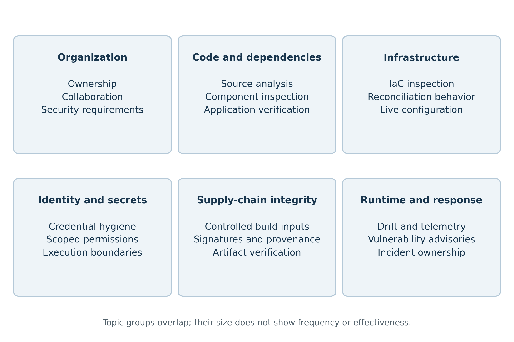
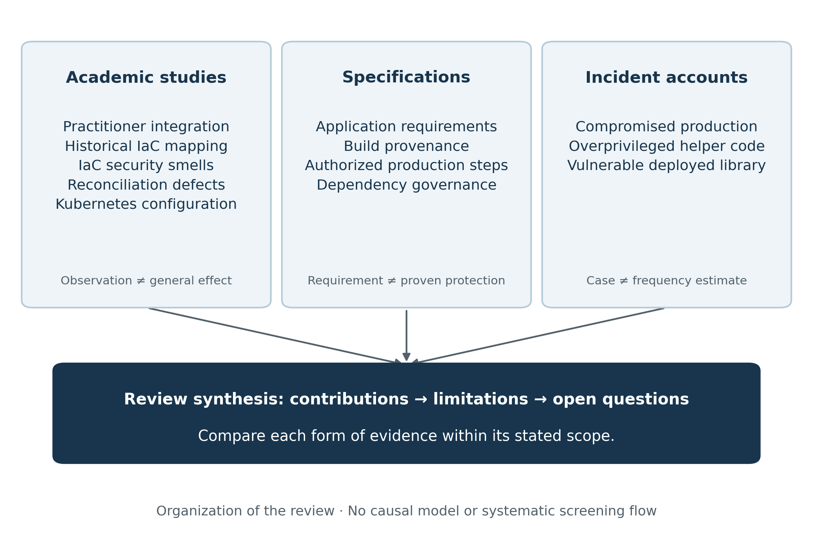
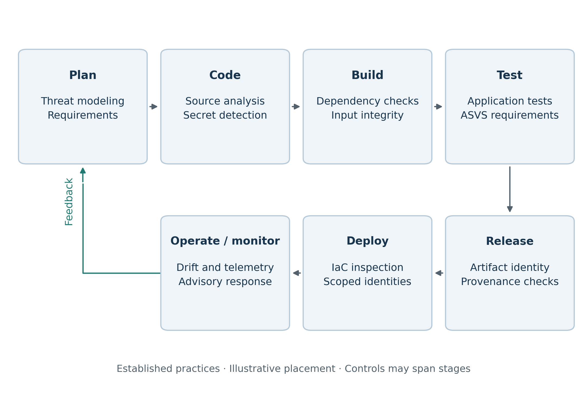
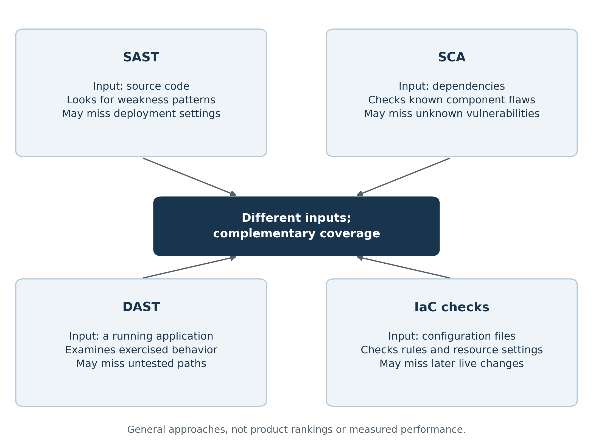
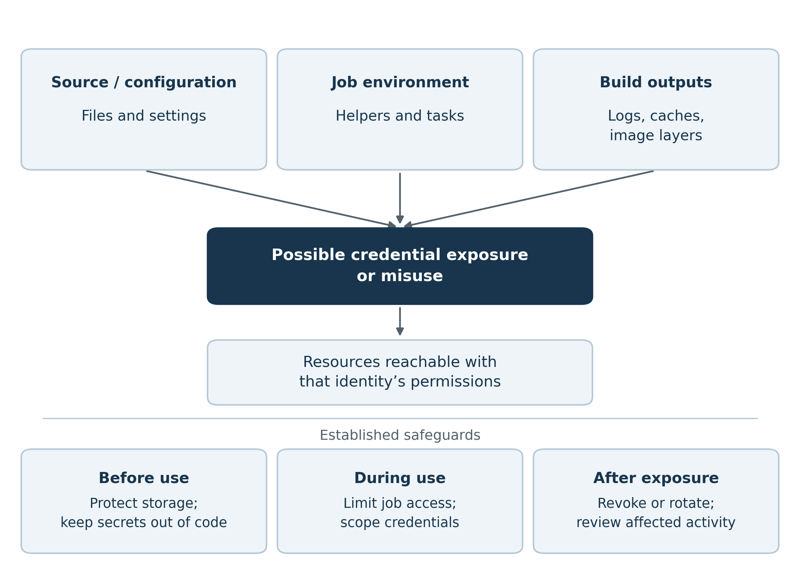
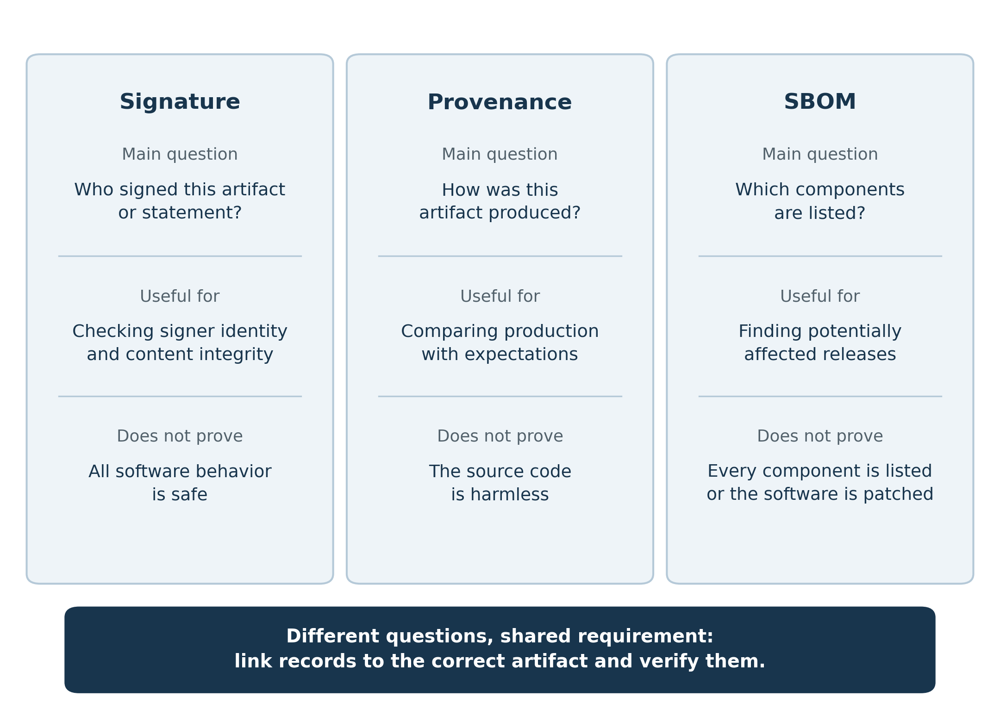
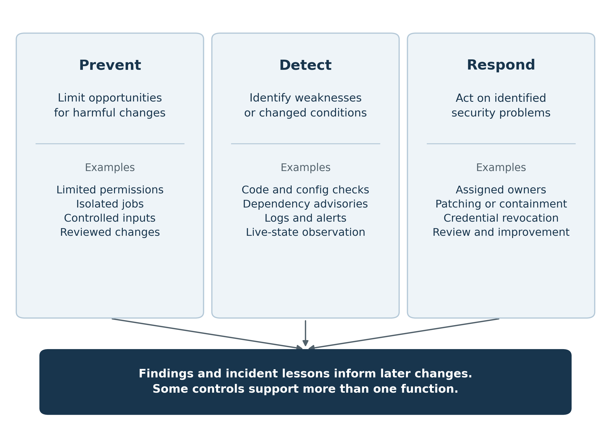

## Abstract

DevSecOps integrates security into software development and delivery. This paper reviews selected studies and guidance on continuous integration and continuous delivery or deployment (CI/CD). It examines teamwork, vulnerability detection, infrastructure as code, credentials, supply-chain integrity, and monitoring. Comparison tables and conceptual figures summarize existing approaches, their contributions, and their limitations.

The review suggests that security depends on complementary controls and clear responsibilities. Key challenges include incomplete detection, excessive permissions, configuration changes, and delayed response. Past incidents illustrate these concerns. The paper discusses existing research and presents no new experiments or technical system.

**Keywords:** DevSecOps; CI/CD; literature review; software security; infrastructure as code; supply-chain security; secrets management; monitoring.

## 1. Introduction

CI/CD automates software integration, testing, and release. Continuous delivery keeps changes ready for release; continuous deployment releases qualifying changes automatically. Pipelines also connect repositories, dependencies, credentials, and production services, making the delivery process itself a security concern.

DevSecOps combines security checks with shared responsibility across development, operations, and security teams. This review compares existing practices, explains their limitations, and identifies remaining questions.

The review addresses four questions:

1. **RQ1:** How do teams integrate security into CI/CD?
2. **RQ2:** Which security approaches support each delivery stage?
3. **RQ3:** What do existing studies and frameworks contribute?
4. **RQ4:** Which challenges and research gaps remain?

## 2. Review Scope and Approach

### 2.1 Sources included

The review considers five academic manuscripts and seven official project or agency sources, selected for relevance. It is a focused review, not a completed systematic search or an exhaustive account of DevSecOps research.

The academic manuscripts come from an author's archive and share a coauthor, limiting independent perspectives. They may differ from final publications. Sources were retrieved on 23 October 2026; coverage through that date is not claimed.

### 2.2 Basis of comparison

Studies are compared by topic, method, reported scope, contribution, and limitation. Frameworks are compared by purpose and coverage. Sample sizes belong to the reviewed studies, not new data collected for this paper.

- **Academic studies** provide findings from particular research settings.
- **Standards and guidance** define requirements and recommended practices.
- **Incident accounts** illustrate specific security failures.

These sources answer different questions and are not combined into one performance score.

### 2.3 Interpreting findings

Using a control does not prove effective protection. A scanner may miss weaknesses, and an alert may remain unresolved. Disputed source figures and unsupported claims about breach frequency or remediation costs are excluded.

## 3. Review of Existing Studies

### 3.1 Teamwork and shared responsibility

The practitioner study describes collaboration, requirements, and security practices within DevOps. It supports clear ownership while retaining limited access. Its small, partly self-reported sample does not establish that collaboration alone reduces breaches.

### 3.2 Infrastructure as code

Infrastructure as code (IaC) uses files and automation to manage resources. The historical mapping study distinguishes tool proposals, adoption, empirical work, and testing. Its older literature set cannot represent the current field, but shows why introducing a tool differs from demonstrating sustained usefulness.

### 3.3 Security smells in infrastructure scripts

Security smells are patterns that may indicate weaknesses, such as hard-coded secrets or insecure defaults. The reviewed study supports inspecting infrastructure code. Findings still require context: a warning is not proof of exploitation, and language-specific rules may not transfer to other platforms.

### 3.4 Infrastructure automation defects

State reconciliation compares desired infrastructure with its current state. The reviewed Ansible study shows that defects in automation can produce unexpected changes. Static checks and observation of the deployed environment therefore provide different, complementary information.

### 3.5 Kubernetes configuration checks

The Kubernetes study examines configurations prescribed by the Center for Internet Security (CIS) and compares five analysis tools. Coverage depends on rules, versions, and input files. Duplicate alerts and shared blind spots mean that more tools do not automatically provide complete protection.

### 3.6 Main literature themes

Figure 1 groups the literature into six overlapping topics. For example, a dependency script can create both a supply-chain risk and a route to credential exposure.

**Figure 1. Main topics covered by the reviewed DevSecOps literature.**

{width=6.5in}

The groups organize the discussion; their size does not indicate frequency or effectiveness.

**Table 1. What the reviewed sources explain and where their conclusions are limited.**

| Type of source | What it explains | Main limit |
|:--|:--|:--|
| Practitioner research | Reported teamwork and security practices | Does not prove a general reduction in breaches |
| Historical literature mapping | Topics covered by a selected set of IaC papers | Does not describe the whole current research field |
| Security-smell research | Repeated warning patterns in infrastructure scripts | A warning does not prove successful exploitation |
| Automation-defect research | Problems in how infrastructure changes are carried out | An approved file does not guarantee the expected live state |
| Configuration-tool studies | Detection and coverage in a particular setting | Findings depend on the tools, versions, and files examined |
| Security standards | Requirements and recommended checks | Publication of a requirement does not prove correct use |
| Incident accounts | Examples of security failures | One incident does not establish overall frequency |

### 3.7 Comparison of studies

Table 2 retains each study's method, scope, contribution, and limitation. Organizations, publications, scripts, and defect records are different units and should not be ranked by sample size alone.

**Table 2. Comparison of the reviewed studies, their methods, and their limitations.**

| Study topic | Method and reported scope | Main contribution | Main limitation |
|:--|:--|:--|:--|
| Security integration in teams | Online-material analysis and survey of nine organizations | Describes collaboration, requirements, and security practices | Small sample and partly self-reported information |
| Historical IaC research | Mapping of 32 publications collected through 2017 | Groups work on tools, adoption, empirical studies, and testing | Historical coverage does not represent the whole current field |
| IaC security smells | Static analysis of 15,232 scripts from 293 repositories | Identifies recurring patterns that may indicate weaknesses | Findings depend on language and context; smells are not confirmed exploits |
| State reconciliation | Analysis of 5,110 Ansible-related defects and eight categories | Shows why automation behavior matters as well as configuration text | Findings are specific to the tools and setting examined |
| Kubernetes configuration | Five tools, 53 prescribed settings, 544 files, and 20 respondents | Identifies limitations in configuration checks and tool coverage | Version and dataset differences affect findings; some source figures need checking |

Figure 2 shows how the source types support the review. Its arrows organize the discussion rather than establish cause and effect.

**Figure 2. Types of sources used to compare existing knowledge and open questions.**

{width=6.5in}

## 4. Comparison of Existing Security Approaches

### 4.1 Frameworks and their purposes

OWASP's CI/CD taxonomy organizes pipeline risks. The OWASP Application Security Verification Standard (ASVS) defines application-security requirements. Both guide assessment, but teams must still implement and verify the relevant checks.

Supply-chain Levels for Software Artifacts (SLSA) describes build-integrity expectations and provenance: information about software production. The in-toto specification checks authorized steps and artifact relationships. Their protection depends on trusted identities, adequate rules, and actual verification.

OpenSSF's Secure Supply Chain Consumption Framework (S2C2F) guides dependency use, while Scorecard checks selected security practices.

The Cybersecurity and Infrastructure Security Agency (CISA) catalog helps prioritize known exploited vulnerabilities. These sources inform different decisions; none proves complete security.

**Table 3. Comparison of security frameworks and information sources.**

| Framework or source | Main question | What it provides | Main limitation |
|:--|:--|:--|:--|
| OWASP CI/CD risk taxonomy | Which pipeline risks should be considered? | Risk categories for reviewing delivery processes | Categories do not show risk frequency or prove effective protection |
| OWASP ASVS 5.0.0 | Which application requirements should be checked? | Requirements for automated and manual security assessment | Teams must still show which requirements were checked and how |
| SLSA v1.1 | What is known about an artifact's build process? | Provenance and checks against trusted build expectations | Correct build information does not prove harmless source code |
| in-toto 1.0.0 | Were the expected steps carried out by authorized actors? | Signed process records and verification rules | Missing rules or compromised trust material can weaken the checks |
| OpenSSF S2C2F | How should open-source components be managed? | Guidance on dependency use and organizational practices | Guidance does not guarantee that components are free from weaknesses |
| OpenSSF Scorecard | Which visible security practices need attention? | Automated checks that support project and dependency review | A score does not give the probability of a compromise |
| CISA exploitation catalog | Is exploitation of a listed vulnerability known? | Information that helps prioritize affected software | A vulnerability may still be exploitable even if it is not listed |

### 4.2 Security across the lifecycle

Security practices extend from planning to operation. Figure 3 summarizes common placements; some controls apply at several stages. Operational feedback helps teams update requirements and maintain protection after release.

**Figure 3. Existing security practices across the software delivery lifecycle.**

{width=6.5in}

### 4.3 Application, dependency, and infrastructure checks

- **SAST:** Static application security testing examines source-code weakness patterns.
- **SCA:** Software composition analysis examines dependencies and known vulnerability information.
- **DAST:** Dynamic application security testing examines a running application's behavior.
- **IaC checks:** Infrastructure analysis examines configuration rules and resource relationships.

Each method observes different information. Combining methods can improve coverage, but overlapping rules may repeat findings or share blind spots.

**Figure 4. Comparison of what SAST, SCA, DAST, and IaC checks examine.**

{width=6.5in}

Actual coverage depends on the tool, configuration, and available context.

### 4.4 Identity and secrets

Secrets can appear in source files, logs, caches, image layers, and job environments. Identity and access management (IAM) should limit each job to the resources needed for its task.

Temporary credentials reduce reuse time, but their permissions still matter. Unreviewed code should not inherit deployment access. Exposed credentials require revocation or rotation and investigation of affected activity.

**Figure 5. Credential exposure risks and established safeguards in CI/CD.**

{width=6.5in}

The arrows show possible exposure paths, not an inevitable attack sequence.

### 4.5 Signatures, provenance, and inventories

Signatures authenticate statements or signer identity; provenance describes production; a software bill of materials (SBOM) lists components. All should refer to the correct artifact. An immutable digest helps identify the exact contents handled across stages.

An SBOM can help locate affected releases after a vulnerability disclosure. It does not patch software or prove non-exploitability. Similarly, valid signatures and production records do not establish harmless behavior.

**Figure 6. Different roles of signatures, provenance, and an SBOM.**

{width=6.5in}

## 5. Lessons from Past Security Incidents

SolarWinds and Codecov are discussed using summaries in the reviewed guidance; their primary reports were not independently retrieved. The Log4Shell discussion uses CISA's vulnerability entry. These cases illustrate mechanisms, not overall incident frequency.

### 5.1 SolarWinds: production trust

SolarWinds illustrates compromise of software production. Protected builds, controlled changes, provenance, and separate release approval address parts of this risk. A valid signature or trusted distribution channel alone does not prove harmless content.

### 5.2 Codecov: helper permissions

Codecov illustrates how helper code can access sensitive build information. Controlled inputs, isolated execution, and narrow permissions limit exposure. Checking a helper's origin and restricting what it can access are complementary safeguards.

### 5.3 Log4Shell: vulnerable dependencies

CISA lists CVE-2021-44228 in Apache Log4j2 as a known exploited remote-code-execution vulnerability. Inventories and deployment records help locate affected software, while assigned owners must update or contain it. A genuine component can still be vulnerable.

**Table 4. Comparison of past incidents and their security lessons.**

| Incident | Problem illustrated | Relevant security practices | Main lesson |
|:--|:--|:--|:--|
| SolarWinds | Compromise of the software production process | Protected builds, controlled changes, provenance checks, separate release approval | A trusted release channel or valid signature does not prove harmless content |
| Codecov | Helper code can access sensitive build information | Controlled inputs, isolated execution, limited permissions, integrity checks | The source of helper code and its execution permissions both matter |
| Log4Shell | A vulnerable genuine component remains in deployed software | Component inventories, advisory monitoring, updates, containment | Finding affected software is useful only when it leads to an effective response |

### 5.4 Weak practices and alternatives

Table 5 compares failure-prone choices with established alternatives. It summarizes guidance rather than estimating how often organizations use each practice.

**Table 5. Comparison of weak security practices and established alternatives.**

| Practice | Why it can cause problems | Established alternative |
|:--|:--|:--|
| Check security only before the final release | Important problems may be found after other work depends on them | Provide earlier feedback and continue checks during release and operation |
| Share one deployment identity across environments | A compromise can affect several projects or environments | Limit identities and permissions to their tasks and environments |
| Run changeable external scripts in privileged jobs | Downloaded code can change without a reviewed repository change | Control inputs, check trusted integrity values, and separate execution |
| Treat every warning as equally urgent | Missing context and repeated alerts can make prioritization difficult | Review relevance, assign owners, and document exceptions |
| Assume a signature proves software is safe | A signature authenticates a statement or origin, not all behavior | Check artifact identity and production information alongside application security |
| Create an SBOM only for an audit | An unused or outdated inventory does not support a timely response | Connect component information to deployments and vulnerability handling |
| Assume automation always restores secure infrastructure | Automation can repeatedly apply an unsafe configuration | Review the intended settings and observe the actual environment |
| Treat an alert as a completed response | The problem may remain unresolved without an owner or action | Maintain clear responsibilities and practical response processes |

## 6. Common Challenges and Research Gaps

### 6.1 Detection coverage

Detection depends on supported languages, rules, inputs, and context. Useful findings explain the affected resource and possible consequence. Alert counts alone cannot show whether the most important weaknesses were found.

### 6.2 Intended and actual infrastructure

Declared configuration, automation behavior, and live state can differ. Defaults, defects, and manual changes complicate this relationship. Static checks and runtime observation help examine different parts of the problem.

### 6.3 Trust in security records

Records are useful only within their trust assumptions. If one compromised authority creates and approves a statement, both activities may fail together. Build records, application tests, and runtime observations should be interpreted according to what they actually establish.

### 6.4 Maintenance and adoption

Rules, dependencies, permissions, and responsibilities change. Controls need continuing maintenance and clear ownership. Overlapping tools can increase work without resolving the most relevant risk, making sustained usability as important as initial installation.

### 6.5 Monitoring and response

Monitoring provides information; response turns findings into action. Incomplete logs, unclear alerts, or missing owners can delay remediation. New vulnerabilities and configuration changes also require reassessment after deployment.

Figure 7 separates prevention, detection, and response. The functions overlap, and a control may support more than one.

**Figure 7. Prevention, detection, and response in the reviewed security practices.**

{width=6.5in}

The grouping explains existing practices and does not introduce a new framework.

**Table 6. Comparison of security approaches across lifecycle stages.**

| Stage | Existing approaches | Main benefit | Common limitation |
|:--|:--|:--|:--|
| Plan | Threat modeling, requirements, assigned responsibilities | Clarifies what needs protection and who is responsible | The analysis can become outdated or disconnected from development |
| Code | Source analysis, secret detection, code review | Finds selected weaknesses before release | Rules and available context do not cover every problem |
| Build | Dependency checks, controlled inputs, isolated builds | Examines components and limits exposure during production | Unknown flaws and compromised trusted inputs remain possible |
| Test | Application testing and requirements-based assessment | Examines behavior and security requirements | Untested paths and different environments limit coverage |
| Release | Signatures, provenance, artifact verification | Helps confirm artifact identity and expected production | Valid records do not prove harmless content |
| Deploy | IaC checks, limited identities, configuration policies | Reviews intended settings and deployment permissions | Automation behavior and later changes can affect the actual result |
| Operate and monitor | Live-state checks, logs, vulnerability monitoring | Helps identify changing conditions after deployment | Missing information or unclear ownership can delay response |

### 6.6 Open questions

Figure 8 and Table 7 summarize questions raised by the selected sources. Wider literature may already address some of them; the review does not claim that these topics are unstudied.

**Figure 8. Open questions identified through the literature comparison.**

{width=6.5in}

**Table 7. Research gaps and possible directions for further study.**

| Topic | What existing work explains | Remaining question | Further work needed |
|:--|:--|:--|:--|
| Teamwork and adoption | How teams report security practices and collaboration | How these practices support security over time in different settings | Reviews of more organizations and longer-term experience |
| Automated detection | How tools identify selected weakness patterns | How context, coverage, and repeated findings affect usefulness | Clearer comparison of tool scope, assumptions, and limitations |
| Infrastructure behavior | How declarations and automation defects affect resources | How intended settings relate to executed changes and live state | Closer connection between configuration and runtime research |
| Supply-chain integrity | How signatures and provenance describe production | What verified records establish about behavior and producer trust | Clearer explanations of trust assumptions and receiving-system checks |
| Identity and secrets | Why credential hygiene and limited access matter | How permissions interact across connected tools and temporary identities | More detailed accounts of access relationships throughout delivery |
| Monitoring and response | How monitoring reveals conditions after deployment | How findings become timely action with clear ownership | Stronger connections between detection and response studies |
| Tool integration | How specialized controls fit into delivery stages | How duplication and maintenance affect continued use | More comparison of integration effort and developer experience |

## 7. Discussion and Limitations

### 7.1 Answers to the review questions

- **RQ1:** Security integration combines teamwork, clear ownership, and technical checks.
- **RQ2:** Controls address different stages, from source review to post-deployment response.
- **RQ3:** Studies provide setting-specific findings; frameworks define risks and expected practices.
- **RQ4:** Coverage, infrastructure behavior, trust, permissions, maintenance, and response remain important challenges.

### 7.2 Main interpretation

The reviewed approaches are complementary. Their value depends on context, implementation, and continued use. Counting tools, warnings, or signed records cannot replace understanding which risks are addressed and which remain unresolved.

### 7.3 Review limitations

- **Selection:** The source set is limited, shares an academic coauthor, and comes from a non-systematic search.
- **Versions:** Author-hosted manuscripts and evolving standards may differ from later publications.
- **Evidence:** Surveys, software artifacts, guidance, and incidents support different conclusions.
- **Incidents:** Secondary summaries cannot establish frequency or guarantee that particular controls would prevent an entire attack.
- **Applicability:** Findings from one setting may not transfer to every organization or technology.

## 8. Conclusion

The reviewed literature connects organizational responsibility with security across code, infrastructure, artifacts, and operation. Each approach has limits, so DevSecOps requires complementary checks, appropriate access, and continued maintenance.

The figures and tables summarize existing knowledge and remaining questions. Broader, independent literature coverage would strengthen the review. No new experimental results or technical solution are claimed.
