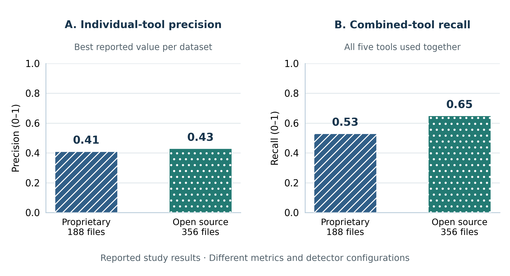
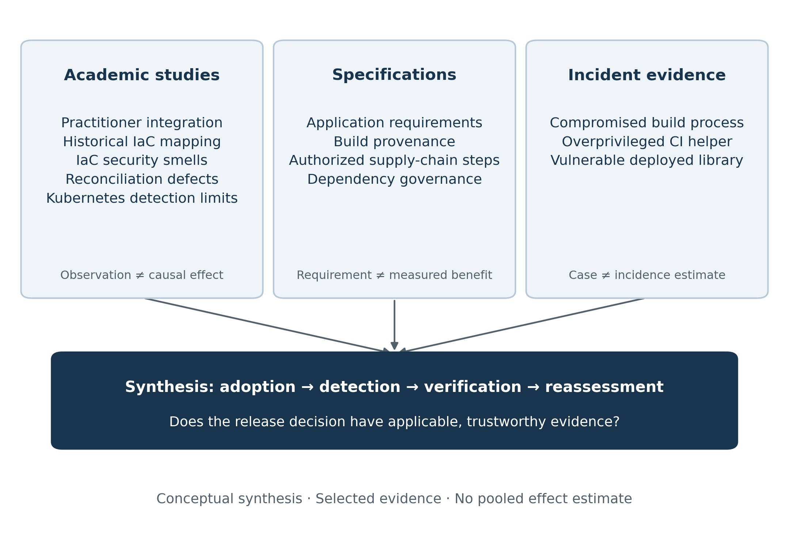
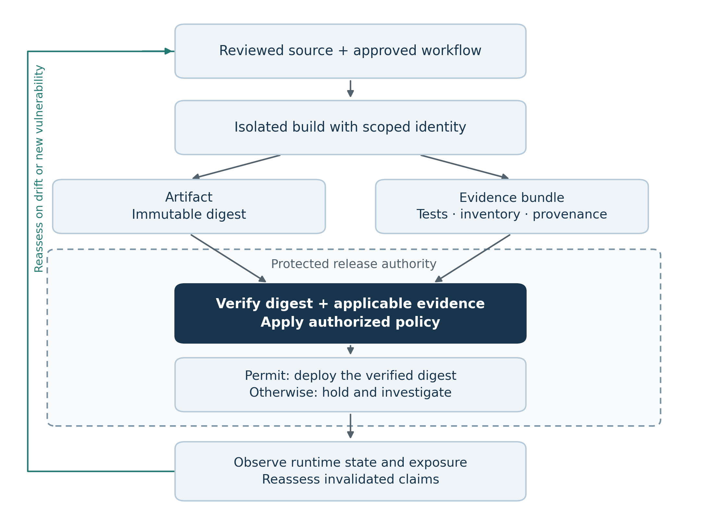
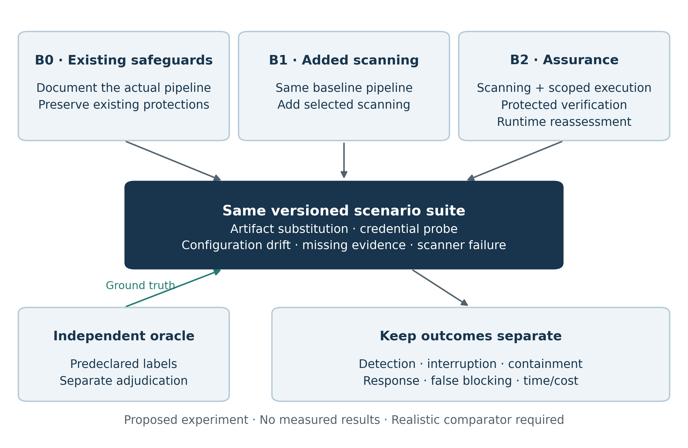

## Abstract

Integrating security scanners into continuous integration and continuous delivery or deployment (CI/CD) pipelines is necessary for many development settings, but scanner integration alone does not establish that a release is trustworthy. A pipeline can execute malicious dependencies, expose credentials, produce misleading security reports, or deploy an artifact different from the one that was tested. This paper develops a critical, evidence-qualified review of DevSecOps through selected empirical studies, infrastructure-as-code research, security specifications, and documented software supply-chain failures. The synthesis distinguishes four outcomes that are frequently conflated: control adoption, defect detection, enforcement, and reduction of exploitable exposure. Practitioner research supports the importance of collaboration but does not demonstrate a universal causal improvement in security. Studies of infrastructure code establish recurring weaknesses, while a Kubernetes configuration study shows that the presence of scanning tools can coexist with limited detection accuracy. SolarWinds, Codecov, and Log4Shell illustrate different failure mechanisms: compromised production processes, excessive execution trust, and vulnerable deployed dependencies. Building on these distinctions, the paper proposes a continuous assurance framework that connects explicit security claims to independently protected evidence, artifact identity, context-sensitive release decisions, and runtime feedback. The framework is a research proposal, not an experimentally validated intervention. A comparative evaluation design specifies baselines, attack scenarios, outcome measures, and threats to validity. The resulting argument shifts evaluation from the number of installed tools toward the integrity, relevance, and operational consequences of the evidence used to authorize software releases.

**Keywords:** DevSecOps; CI/CD; software supply-chain security; infrastructure as code; continuous assurance; policy as code; workload identity; security evaluation.

## 1. Introduction

Modern delivery pipelines do more than compile and test software. They execute repository-controlled commands, retrieve dependencies, access registries, request cloud credentials, publish artifacts, and modify production infrastructure. Their combination of automation and privilege makes them security-sensitive systems in their own right. Consequently, securing application code and securing the system that delivers that code are related but distinct tasks.

DevOps encompasses collaborative practices and feedback across development and operations. CI automates integration and verification of changes. Continuous delivery maintains software in a releasable state, whereas continuous deployment automatically promotes qualifying changes to production. DevSecOps extends shared responsibility to security decisions throughout this lifecycle. These definitions do not imply that every organization requires the same deployment frequency, architecture, or control stack. Nor does the absence of a particular commercial tool establish the absence of security.

Secrets, misconfiguration, identity, and continuous monitoring are important concerns. However, an explanatory model based on a binary comparison between pipelines “with security” and “without security” is too coarse for advanced research. Real systems combine effective controls, incomplete coverage, exceptions, inherited safeguards, and failures of enforcement. A more useful question is: **Under which threat assumptions, and with what evidence, does a particular combination of delivery controls reduce the opportunity or consequences of compromise?**

This question challenges three common assumptions. First, a scanner's presence does not establish its accuracy or deployment coverage. Second, a signed artifact can faithfully preserve malicious output from a compromised or malicious producer. Third, evidence generated inside the same compromised execution context as the artifact may provide little independent assurance. OWASP's CI/CD risk taxonomy and SLSA's treatment of supply-chain threats support examining these boundaries explicitly.

This paper makes three bounded contributions. It provides a critical synthesis organized around what different evidence types can support; develops a failure-to-defense analysis that includes the limitations of proposed remedies; and specifies a continuous assurance framework with falsifiable evaluation criteria. It does not claim a comprehensive literature search, a new security standard, or measured effectiveness of the proposed framework.

The review addresses four research questions:

1. **RQ1:** What do selected studies and specifications establish about DevSecOps practices, and where do their conclusions stop?
2. **RQ2:** Which failure mechanisms remain possible when security tools are already integrated into CI/CD?
3. **RQ3:** How can security claims, delivery evidence, and enforcement decisions be connected across trust boundaries?
4. **RQ4:** How should the resulting intervention be evaluated without confusing scanner activity with security improvement?

## 2. Review Design and Evidential Boundaries

### 2.1 Review type and source selection

This manuscript is a **critical review with a proposed systematic-review protocol**, rather than a completed systematic literature review. A systematic review requires an auditable search, screening record, study corpus, and synthesis method. The present study uses purposive source selection and does not report those systematic procedures as completed. Its title and claims reflect that methodological boundary.

The substantive source set comprises five academic manuscripts and seven official project or agency sources. Academic manuscripts were obtained from an author's public publication archive and examined for their questions, methods, reported outcomes, and limitations. The other sources were selected for direct relevance to pipeline threats, provenance, application verification, dependency consumption, security heuristics, and known exploitation. Official GitHub-hosted material was accessible during preparation; several publisher and agency websites were unavailable through the environment's network policy. Source retrieval took place on 23 October 2026; this date does not establish exhaustive coverage through 2026.

Selection was purposive and access-constrained. All five academic manuscripts share a coauthor, creating a substantial concentration of perspective. Author-hosted versions may differ from the final published articles. These constraints permit a transparent, bounded synthesis, but they prevent claims about the prevalence of positions across the entire DevSecOps literature. A broader, independently reproducible search remains necessary before systematic-review claims are warranted.

### 2.2 Extraction and critical appraisal

For each academic source, the analysis records the research setting, design, unit of analysis, principal result used here, and an inference the design cannot support. Specifications are examined for their stated mechanisms and scope rather than treated as experiments. Incident descriptions are used to identify plausible failure mechanisms, without estimating their population frequency.

The appraisal asks whether the source defines its target weakness; provides inspectable methods or requirements; connects findings to a stated context; discusses uncertainty; and supports the strength of the claim being made. These dimensions are reported narratively. An unvalidated numerical “quality score” would conceal consequential differences between study designs.

Four evidence categories remain separate throughout:

- **Empirical evidence:** observations from a defined sample, experiment, or practitioner study.
- **Normative evidence:** a specification or recommended practice describing intended behavior.
- **Incident evidence:** a documented occurrence illustrating a failure mechanism.
- **Proposed reasoning:** this paper's deductions, framework, and hypotheses, awaiting evaluation.

These categories cannot be pooled into a common effect size. A count of suspicious configurations, a practitioner opinion, and an artifact-integrity requirement measure different constructs. No meta-analysis or causal security-effect estimate is attempted.

### 2.3 Claim discipline and measurement validity

Universal remediation-cost multipliers, claims about the leading cause of cloud breaches, and deterministic statements that particular tools prevent breaches are not adopted. Such claims require a defined population, period, comparison, and supporting evidence. Study-specific numerical results are used only when their source and measurement context can be inspected; untraceable counts are excluded.

Likewise, zero detections in a pipeline without detection instrumentation cannot be interpreted as zero underlying weaknesses. A meaningful comparison requires an independent reference set, consistent units, and a measure of what was missed. Increased detection after instrumentation can indicate better visibility rather than deteriorating software quality.

## 3. Critical Literature Review: From Adoption to Assurance

### 3.1 Organizational integration is an enabling condition

An exploratory practitioner study combines analysis of Internet artifacts with a survey of representatives from nine organizations. The consulted manuscript reports collaboration, security requirements, configuration practices, and both automated and non-automated activities. Its importance is conceptual and organizational: DevSecOps cannot be reduced to adding a scanner at one pipeline stage.

The study also qualifies the usual celebration of collaboration. Unrestricted collaboration can expose resources to inappropriate access, and rapid automated deployment can become harmful when security practices are overlooked. Shared responsibility therefore needs explicit authority boundaries. Responsibility for identifying a risk can be distributed while permission to authorize a production identity remains tightly controlled.

The evidence is exploratory and partly self-reported. The authors explicitly do not establish a relationship between automation and the quality of deployed software. Their findings justify investigating collaboration as a mechanism of adoption; they do not justify a numerical claim that collaboration or DevSecOps causes fewer breaches across organizations. Team maturity, architecture, resources, and existing security investment remain plausible alternative explanations.

### 3.2 Tool proposals and security outcomes are different research products

A historical mapping study organizes infrastructure-as-code research into frameworks or tools, adoption, empirical studies, and testing. Its selected historical corpus contains 32 publications, half categorized as framework or tool work. This describes the literature they searched, with a collection date in 2017; it is not a description of all research available in 2026.

The methodological lesson is broader than the dated distribution. Proposing a tool, demonstrating that it runs, and showing that it reduces exploitable exposure are different contributions. A successful integration demonstration may establish feasibility while leaving accuracy, sustained use, bypass resistance, and operational benefit unresolved. Accordingly, an advanced DevSecOps review should classify evaluation maturity rather than count tools as equivalent evidence of progress.

### 3.3 Infrastructure weaknesses require contextual interpretation

An empirical security-smell study identifies recurring weakness patterns in infrastructure code and implements a static-analysis tool. The consulted manuscript examines 15,232 scripts from 293 open-source repositories. Its principal contribution is a grounded characterization of recurring weakness patterns, including hard-coded secrets and insecure defaults, together with evidence that such patterns can persist.

Crucially, a smell is an indicator requiring investigation, not proof that an adversary successfully exploited a deployed system. Developer disagreement in the study highlights the role of context, such as examples intended for training. Conversely, a supposedly harmless example can be copied into production. The defensible response is contextual triage with accountable decisions, rather than either unconditional acceptance of every warning or blanket dismissal of examples.

The study supports automated inspection of infrastructure code. It does not establish complete coverage of modern Terraform, Kubernetes, managed-service policies, or provider-specific runtime behavior. Generalizing rules across languages and services requires new validation. Its evidence also does not convert a count of smell occurrences into an incident rate.

### 3.4 The reconciliation engine is part of the threat surface

A state-reconciliation study examines 5,110 defects associated with Ansible and identifies eight defect categories. It also investigates using derived heuristics with an LLM to discover additional defects. This extends the unit of analysis beyond configuration files: the engine that interprets intended state can itself behave incorrectly.

That distinction undermines a simplistic claim that a successful IaC scan guarantees secure deployment. A scanner may inspect a declarative file while the deployed result depends on provider behavior, inventories, variables, API responses, and reconciliation semantics. A configuration can therefore satisfy a static policy and still produce an unintended live state.

The paper's defect corpus and validation approach are specific to their investigated setting. Its LLM-assisted discovery results do not establish reliable autonomous remediation or general effectiveness across IaC systems. A defensible extension is to test state transitions and observe resulting infrastructure alongside static policy checks, while treating generated tests and fixes as artifacts requiring validation.

### 3.5 Scanner availability does not establish detection adequacy

A Kubernetes configuration study examines 53 CIS-prescribed configurations, 20 survey respondents, and 544 configuration files from proprietary and open-source settings. Its evaluation of five static-analysis tools supplies direct counterevidence to the assumption that installing multiple scanners ensures comprehensive protection.

The consulted version reports highest aggregate precision values of 0.41 and 0.43 for individual tools in the proprietary and open-source datasets, respectively. It also reports recall of 0.53 and 0.65 for the combination of all five tools. These values describe the authors' rule mappings, datasets, and tested configurations. They are not current benchmark rankings or universal performance characteristics of those products. The source version also contains inconsistencies in some prevalence counts and summary figures; those figures are not reused here and require checking against the final publication.

The practical implication is conditional. Combining tools can expand coverage, but correlated rules, noisy results, incomplete mappings, and maintenance burden can limit the gain. The relevant question is the additional correctly identified weaknesses or interrupted attack paths per unit of effort. More alerts alone do not answer it. Figure 1 visualizes the reported precision and recall separately so that distinct detector configurations are not presented as a single improvement estimate.

**Figure 1. Reported detection results in the reviewed Kubernetes configuration study.**

{width=6.5in}

Panel A shows the highest reported individual-tool precision in each dataset; Panel B shows recall when all five tools are combined. The datasets contain 188 proprietary and 356 open-source configuration files. These are different metrics and detector configurations, not before-and-after measurements. The values describe the consulted source version, not current tool rankings; no new uncertainty intervals or experimental results are estimated here.

### 3.6 Standards address complementary assurance questions

OWASP's CI/CD taxonomy identifies risks including poisoned pipeline execution, inadequate identity management, credential hygiene, insufficient pipeline access controls, artifact-integrity failures, and limited visibility. Its categories are useful for threat coverage; their existence does not establish incidence rates or the effectiveness of a particular remediation in a particular organization.

SLSA v1.1 focuses on supply-chain integrity and increasingly strong build guarantees. The reviewed version distinguishes provenance that exists, authenticated provenance from a hosted build platform, and stronger protection against build tampering. This paper deliberately names the reviewed version instead of claiming it is the latest release. SLSA's own scope excludes guarantees about source-code quality or a producer's benign intent.

The in-toto specification describes signed metadata and verification of expected supply-chain steps, authorized actors, and artifact relationships. Its contribution is evidence structure and verification semantics. Its protection depends on a correctly specified layout, protected authorization material, and an actual verifier. Recording incomplete materials or accepting overly broad artifact rules can undermine the intended chain.

OWASP ASVS 5.0.0 provides application-security verification requirements. It is not a scanner and does not automatically verify its own requirements. Some requirements can be supported by automation; others require architectural reasoning, authenticated testing, or manual assessment. Claiming ASVS alignment requires a versioned requirement-to-evidence mapping with stated exclusions.

OpenSSF's S2C2F addresses secure consumption of open-source dependencies, while Scorecard exposes security-practice heuristics. These can inform dependency governance, but a practice score is not a calibrated probability of compromise. CISA's Known Exploited Vulnerabilities catalog supplies evidence of known exploitation for listed vulnerabilities. Absence from that catalog does not establish non-exploitability.

**Table 1. What the reviewed evidence supports, and what remains unproven.**

| Evidence stream | Supported contribution | Inference that is not established |
|:--|:--|:--|
| Practitioner study | Reported collaboration and security practices | Universal causal reduction in breaches |
| Historical mapping study | Categorization of its selected IaC literature | Present-day distribution of all DevSecOps research |
| Security-smell study | Recurring weakness patterns in its sampled scripts | Successful exploitation or complete language coverage |
| Reconciliation-defect study | Defects in the examined automation engine | Correct live state from static configuration approval |
| Kubernetes evaluation | Context-specific evidence of detection limitations | Current universal tool rankings |
| Specifications and guidance | Threat categories, requirements, and verification mechanisms | Measured deployment benefit from adoption alone |
| Exploitation catalog | Known exploitation of its listed vulnerabilities | Completeness of all exploitable weaknesses |

### 3.7 Comparison of the reviewed empirical and secondary studies

Table 2 compares the academic studies by design and evidential contribution. A survey, a mapping study, a mined defect corpus, and a detector evaluation do not provide interchangeable estimates of effectiveness. The comparison therefore retains each study's unit of analysis and identifies the inference that remains unresolved. It does not rank studies by sample size or treat larger artifact collections as automatically stronger causal evidence.

**Table 2. Comparison of research designs, samples, contributions, and limitations.**

| Study focus | Design and sample | Contribution to this review | Limitation and resulting research need |
|:--|:--|:--|:--|
| Organizational integration | Exploratory artifact analysis and survey of nine organizations | Collaboration, security requirements, and shared practices help explain adoption | Self-report and a small organizational sample do not establish breach reduction; evaluate behavior and outcomes longitudinally |
| Historical IaC research landscape | Systematic mapping of 32 publications; collection completed in 2017 | Half of the selected corpus concerns frameworks or tools, distinguishing proposals from evaluated outcomes | Historical and search-dependent coverage cannot describe today's field; repeat searches and compare evaluation maturity |
| Security smells in IaC | Static-analysis study of 15,232 scripts from 293 open-source repositories | Recurring configuration weaknesses motivate automated inspection and contextual triage | A smell is not a confirmed exploit; validate rules in additional languages and deployed contexts |
| State reconciliation | Analysis of 5,110 Ansible-related defects, yielding eight categories | Execution-engine behavior can invalidate assumptions based only on approved configuration text | Findings are tied to the investigated orchestrator; test state transitions and live effects in other systems |
| Kubernetes configuration detection | Five tools; 53 prescribed configurations; 544 files and 20 survey respondents | Reported precision and combined-tool recall reveal detection limitations despite tool availability | Results depend on versions, rule mappings, and datasets; validate independently and reconcile source-version discrepancies |

The repeated gap across these designs is the distance between an intermediate observation and an operational outcome. Reported collaboration does not prove correct authorization; detected smells do not prove containment; a compliant configuration file does not prove correct execution. Figure 2 maps these evidence streams to the questions the proposed framework must still answer.

**Figure 2. Evidence map linking reviewed literature and incidents to unresolved assurance questions.**

{width=6.5in}

This is a conceptual synthesis of the selected material. Arrows show how the analysis informs research questions; they do not indicate causality, effect size, a completed systematic-search flow, or a validated maturity scale. The final assurance chain is a proposed response to the identified boundaries, not a result demonstrated by the reviewed studies.

### 3.8 Comparison of complementary security frameworks

Table 3 compares the primary assurance question addressed by each reviewed framework or information source. The entries describe mechanisms and intended scope, not benchmark results or exclusive capabilities. Their complementarity explains why adopting a single checklist, inventory, or signature mechanism cannot establish end-to-end delivery security.

**Table 3. Comparison of security frameworks, evidence mechanisms, and remaining uncertainty.**

| Framework or source | Primary question addressed | Evidence or decision mechanism | Remaining uncertainty |
|:--|:--|:--|:--|
| OWASP CI/CD risk taxonomy | Which delivery-process threats should be considered? | Threat categories guide pipeline assessment and control selection | A taxonomy does not measure incidence, deploy controls, or prove their effectiveness |
| OWASP ASVS 5.0.0 | Which application-security requirements should be verified? | Versioned requirements mapped to automated and manual assessment | Requirement coverage and evidence quality must be established; application checks do not secure the builder by themselves |
| SLSA v1.1 | How was an artifact built, and what build-integrity guarantees apply? | Provenance, builder trust, and consumer verification against expectations | Correct provenance does not prove benign source code or producer intent |
| in-toto 1.0.0 | Were authorized supply-chain steps and artifact relationships followed? | Signed layouts and step metadata checked against defined rules | Incomplete layouts, broad rules, or compromised trust roots can weaken verification |
| OpenSSF S2C2F | How should open-source consumption be governed? | Dependency-ingestion practices and a maturity-based implementation guide | A governance model does not itself establish absence of malicious or vulnerable dependencies |
| OpenSSF Scorecard | Which observable security-practice heuristics warrant attention? | Automated checks provide signals for maintenance and dependency decisions | A score is not a calibrated compromise probability or proof of safe behavior |
| CISA exploitation catalog | Is exploitation of a listed vulnerability already known? | Catalog entries support prioritization of affected assets | Unlisted weaknesses may still be exploitable; asset exposure must be assessed separately |

Together, Tables 2 and 3 motivate evaluating the complete claim-to-decision chain. Empirical observations can identify a weakness; a specification can structure evidence; an enforcement point must still decide whether the evidence applies to the exact artifact and deployment context. Runtime reassessment is needed when that context changes.

## 4. Threat Model and Defensive Objectives

### 4.1 Assets, adversaries, and trust boundaries

The protected assets are source and workflow integrity, credentials, dependency authenticity, build outputs, release decisions, production configuration, and the evidence used to authorize deployment. Confidential source code and application data matter, but this paper focuses on the delivery path and its ability to modify production.

Consider adversaries who can submit an untrusted change, compromise a dependency, alter a remotely retrieved build script, exploit a runner, steal a workload credential, or modify an artifact registry. Additional scenarios include a malicious maintainer and an actor with authority to edit security policy. These capabilities differ materially and should not be collapsed into a single “attacker” condition.

Trust boundaries separate external contributions from privileged builds; build execution from deployment authorization; artifact storage from artifact acceptance; intended configuration from live state; and operational telemetry from the workloads being monitored. OWASP's discussion of poisoned pipeline execution explains why protecting only the top-level workflow file is insufficient: tests, build files, plugins, and repository scripts can also execute attacker-controlled commands.

The framework assumes that some root of trust remains intact: for example, protected deployment authorization and its verification keys. If an adversary controls the builder, verifier, policy authority, and logging administration simultaneously, the available evidence cannot establish trustworthy release authorization. Stronger claims require stronger separation or independently operated verification.

### 4.2 Four defensive objectives

The analysis distinguishes prevention of unauthorized release changes; containment of execution privilege; detection of weaknesses and malicious behavior; and recovery to a known acceptable state. These objectives should be tested separately. A control can fail to prevent an initial execution while still reducing its blast radius or enabling earlier containment.

Defense in depth is most useful when layers address different failure modes or are protected by different authorities. Five scanners running under the same compromised identity may provide less independent assurance than fewer controls distributed across build isolation, authorization, artifact verification, and runtime observation. Counting layers without examining common dependencies overstates resilience.

## 5. Historical Failures and the Limits of Proposed Remedies

Historical incidents illustrate mechanisms; they do not prove that a proposed control would have prevented every stage of the actual attack. SolarWinds and Codecov are discussed using published security-taxonomy and supply-chain-framework summaries. Those primary incident reports were not independently retrieved for this review. Log4Shell's known exploitation is supported directly by CISA's catalog entry for CVE-2021-44228. Counterfactual defenses below are this paper's analysis.

### 5.1 SolarWinds: trusted distribution can preserve malicious output

The SolarWinds incident illustrates compromise of a software production process, rather than merely the inclusion of an obviously vulnerable dependency. The central defensive error is to treat delivery through a recognized producer's release channel as sufficient evidence of benign content.

A proposed response combines protected build infrastructure, restricted workflow changes, trustworthy provenance, and verification at the point of consumption. For appropriate threat models, independently operated reproducible builds can supply additional evidence. These controls address different questions: provenance describes an artifact's production; reproducibility compares independently produced outputs; application testing examines behavior.

None of these mechanisms alone proves benign intent. A malicious source change may be reproducibly built and correctly signed. A compromised authority may authenticate misleading evidence. The research requirement is therefore to specify which actor or stage may be compromised and which independent check is expected to expose the discrepancy.

### 5.2 Codecov: build-time helpers can inherit excessive authority

The Codecov incident illustrates how a compromised externally supplied CI helper can access sensitive information available to a build. Its lesson extends beyond source scanning: operational convenience often grants third-party code the authority of the whole job.

Proposed defenses include immutable dependency references, integrity verification against an independently trusted expectation, separation of low-trust tooling from credential-bearing stages, narrowly scoped temporary credentials, and restricted network egress. A checksum fetched from the same compromised location as its payload supplies weak independent evidence. Similarly, a pinned revision fixes identity but does not establish that the fixed content is benign.

Temporary credentials reduce the duration of exposure; they do not prevent misuse during their validity. Workload identity based on OpenID Connect requires constrained trust conditions, such as expected repository, audience, and execution context. A broad federation policy can simply replace a long-lived overprivileged secret with a repeatedly obtainable overprivileged token.

### 5.3 Log4Shell: inventory is useful only when it drives response

CISA identifies CVE-2021-44228 in Apache Log4j2 as a known exploited remote-code-execution vulnerability. This failure differs from build tampering: a legitimate dependency can introduce exploitable behavior into deployed applications.

An artifact-linked software bill of materials (SBOM) can help locate potentially affected releases. Its usefulness depends on inventory completeness, component identification, connection to deployment records, and the organization's ability to update or contain affected systems. The SBOM itself neither patches a component nor proves whether a vulnerable code path is reachable.

The proposed response links dependency inventory to deployed artifact digests, rescans retained inventories when new advisories appear, validates affected configurations, and rehearses patching or containment. Reachability analysis can prioritize investigation, but uncertain analysis should not be converted into a confident finding of non-exploitability. A signed vulnerability assessment must still carry supporting evidence and a revision policy.

**Table 4. Historical mechanism, proposed defense, and residual limitation.**

| Case and mechanism | Proposed defensive response | Residual limitation | Proposed validation |
|:--|:--|:--|:--|
| SolarWinds: compromised production process | Protected builds; independent authorization; verified provenance | Valid evidence can describe malicious authorized source | Substitute output and separately test malicious-source scenarios |
| Codecov: CI helper inherits job access | Isolate helper execution; verify immutable inputs; reduce credentials and egress | Approved destinations or live short-lived tokens can still be abused | Use harmless canary secrets to test isolation and access restrictions |
| Log4Shell: vulnerable deployed dependency | Artifact-linked inventory; advisory response; tested update or containment | Incomplete inventory and uncertain reachability can hide exposure | Seed a test dependency and measure identification through remediation |

### 5.4 Failure-prone practices and defensive alternatives

Security technologies can fail through mismatched assumptions, incomplete adoption, or inappropriate use. Analyzing the failure mechanism produces more actionable conclusions than labeling an entire technology inherently unsafe. Table 5 reframes problematic practices as testable anti-patterns. These are analytical categories, not estimates of how often organizations use them.

**Table 5. Failure-prone practices and defensible alternatives.**

| Practice | Why it fails | Proposed alternative and necessary qualification |
|:--|:--|:--|
| Security only at the final release checkpoint | Late discovery can force a choice between delay and unmanaged exposure | Early feedback plus deployment and runtime verification; early testing cannot replace later evidence |
| A single shared deployment identity | Compromise crosses projects and environments | Per-workload and per-environment identities; test effective authorization rather than role names |
| Execute mutable remote scripts in privileged jobs | Retrieved code changes without a reviewed repository change | Approved immutable inputs, verified integrity, and execution isolation; pinning alone does not establish safety |
| Block every release on every scanner warning | Noise, irrelevance, and latency can encourage bypass | Calibrated risk policy, tracked exceptions, and measured false-blocking costs |
| Treat a signature as proof of safe behavior | Authentication of origin does not establish benign content | Verify signer, artifact digest, source and builder expectations, and independent security checks |
| Treat an SBOM as a compliance endpoint | A stale inventory cannot support current exposure decisions | Bind inventory to an artifact and deployment, then trigger reassessment on new information |
| Assume GitOps reconciliation establishes security | An unsafe desired state can be restored repeatedly | Review policy and desired state; observe actual state and test reconciliation behavior |
| Aggregate every result into a single security score | Different denominators and correlated findings lose meaning | Report threat-specific coverage, enforcement, workload, and residual uncertainty |
| Add an LLM as an autonomous security approver | Plausible explanations can lack evidence or miss execution semantics | Use generated output as a candidate artifact; independently validate it before authorization |

## 6. Proposed Continuous Assurance Framework

### 6.1 Design rationale and relationship to prior work

The framework organizes existing mechanisms into a claim-to-decision chain. It combines organizational integration, configuration and execution safeguards, explicit threat categories, and structured verification. It is not presented as the first use of assurance reasoning, provenance, or policy as code. Its proposed contribution is an evaluable arrangement that exposes the assumptions linking a release claim to its supporting evidence and enforcement point.

For each material release claim, record:

`claim → threat and context → control → evidence → verifier → decision → expiry or reassessment trigger`

For example: “Only the approved artifact can run in production” becomes a claim about a named artifact digest, accepted source revision, authorized builder, required attestations, and a deployment verifier. The evidence must be bound to the same artifact that is admitted. The claim is invalidated if deployment uses a mutable tag resolving to different bytes or if its policy is changed without authorization.

### 6.2 Five assurance boundaries

**Boundary A — source and workflow authorization.** Protect changes that affect build and deployment behavior, including transitive scripts and reusable workflows. Separate untrusted contribution testing from credential-bearing execution. Record the reviewed revision and identities authorized to change security policy.

**Boundary B — isolated and observable production.** Use execution environments with bounded identities, controlled dependencies, and explicit network access. Reset runner state between trust contexts where feasible. Cache reuse requires integrity checks and separation by trust domain; an ephemeral runner can still consume a poisoned shared cache.

**Boundary C — artifact and evidence binding.** Build once and promote the same immutable artifact. Associate the digest with tests, dependency inventory, relevant configuration, tool and rule versions, and provenance. Signatures authenticate statements; verifiers must also inspect whether the statements satisfy the expected source, builder, and policy.

**Boundary D — release authorization.** Evaluate mandatory integrity conditions and contextual risk rules using an authority that the ordinary build job cannot alter. Missing required evidence is an explicit state, distinct from a passing result. Policy and trust-root changes require their own authorization and audit trail.

**Boundary E — runtime observation and reassessment.** Observe deployed digests, effective privileges, security-relevant configuration, and detection events. Reassess when a new vulnerability is disclosed, a credential is revoked, configuration drifts, or evidence becomes stale. Feed confirmed failures back into regression cases and policy maintenance.

Figure 3 separates artifact production from the authority that evaluates evidence and authorizes release. Artifact identity binds the evidence bundle to the bytes being admitted. The runtime feedback path invalidates stale claims when new vulnerabilities, configuration changes, or credential events occur.

**Figure 3. Proposed architecture separating artifact production, evidence, and release authority.**

{width=6.5in}

The diagram is a proposed architecture, not a tested implementation. “Protected verification” requires independently controlled policy and authorization that survive the modeled build compromise. A separate box alone does not establish independence. The feedback arrow represents reassessment rather than automatic permission to deploy again.

### 6.3 Release policy and exception governance

A release decision should not be a blanket comparison of all CVSS scores against one threshold. Technical severity, known exploitation, reachable behavior, exposed assets, privileges, and remediation feasibility answer different questions. Their combination requires a documented organizational policy. An uncalibrated weighted sum should not be described as a probability of compromise.

For artifact `a`, target environment `x`, and decision time `t`, the proposed decision rule is:

`Permit(a,x,t) = Integrity(a) AND RequiredEvidence(a,x,t) AND [RiskPolicy(a,x,t) OR AuthorizedException(a,x,t)]`

`Integrity` includes artifact identity and required provenance verification. `RequiredEvidence` checks applicable evidence, its authenticity, and its freshness. `RiskPolicy` represents contextual release requirements. An exception records a named owner, reason, scope, compensating controls, and expiry. In this design, ordinary risk exceptions cannot override artifact-integrity requirements. Emergency procedures need an independently authorized, auditable path with explicitly narrower claims and subsequent review.

Unknown evidence must remain unknown. A scanner timeout, parser error, or zero-test execution is not equivalent to a clean result. For high-impact releases, missing mandatory evidence blocks normal authorization. Lower-impact environments can use different documented rules. This proportionality is preferable to silently failing open or making all environments equally restrictive.

### 6.4 Evidence freshness and contradictory observations

Evidence has several lifetimes. A test result may remain linked to unchanged bytes; the vulnerability interpretation of those bytes may change immediately after a disclosure. A deployment authorization may expire when credentials, target configuration, or trust roots change. Therefore, freshness should be determined by the claim and its invalidation triggers rather than a single global time-to-live.

Conflicting evidence also requires a decision rule. A passing IaC scan and a live resource exposed to the public Internet describe different states. The latter should trigger investigation rather than be averaged into a favorable score. Similarly, an attestation about one digest cannot support a decision about another, even if both artifacts have the same release label.

### 6.5 Practical control mapping

**Table 6. Illustrative mechanisms and the evidence they must produce.**

| Objective | Illustrative mechanism | Required evidence | Remaining uncertainty |
|:--|:--|:--|:--|
| Detect exposed secrets | Secret scanner and incident workflow | Finding, affected revision, triage and revocation record | Undetected formats and exposure outside scanned locations |
| Inspect code and dependencies | SAST and composition analysis | Tool/rule versions, coverage, findings, suppression rationale | Business logic, new vulnerabilities, incomplete reachability |
| Verify application requirements | ASVS-aligned automated and manual checks | Versioned requirement-to-test mapping and justified exclusions | Untested paths and environment differences |
| Assess infrastructure | IaC checks plus live-state inspection | Rendered input, relevant plan, effective deployed configuration | Provider defects and later drift |
| Limit credential abuse | Scoped temporary workload identity | Federation conditions, effective permissions, revocation test | Misuse within an authorized session |
| Protect promotion integrity | Provenance and digest verification | Expected source/builder binding and deployment acceptance record | Compromised trusted producer or verifier |
| Detect and contain runtime attacks | Runtime rules and rehearsed response | Triggered test event, delivery record, response timing | Evasion and unobserved behavior |

Products such as Gitleaks, Semgrep, Trivy, Checkov, OPA, Cosign, and Falco are possible implementations of parts of this mapping. This review does not benchmark, recommend a mandatory combination of, or establish current feature completeness for those products. Cluster configuration assessment belongs to an appropriate cluster context; an application image scan does not establish the security of the target cluster.

## 7. Evaluation Design and Research Agenda

### 7.1 Comparators and experimental scope

The framework requires evaluation before effectiveness claims are warranted. A feasible first study compares three conditions in an isolated testbed: **B0**, a representative pipeline with its existing organizational safeguards; **B1**, the same pipeline with selected scanning added; and **B2**, scanning plus protected evidence verification, scoped execution, and runtime reassessment. B0 should be documented faithfully rather than weakened to create an artificial “no security” baseline.

Use versioned applications, dependency sets, infrastructure configurations, and delivery workflows. Include at least one setting with meaningful authenticated application behavior and one infrastructure deployment scenario. Match control configurations across conditions where possible, and preserve legitimate approvals and emergency needs. Never expose production systems or use real customer secrets for attack experiments.

Figure 4 summarizes the proposed comparison. The same independently labeled scenario set is exercised in each condition; the outcome domains remain separate. The design tests whether additional verification and isolation change attack outcomes and operational cost, rather than assuming that the condition with more controls must perform better.

**Figure 4. Proposed comparative evaluation of existing safeguards, added scanning, and continuous assurance.**

{width=6.5in}

This figure specifies a study to be conducted. It contains no measured performance values, and the framework's effectiveness remains unestablished. Existing safeguards in B0 must be preserved and documented to avoid an artificially weak comparator.

### 7.2 Threat-specific tests and independent ground truth

Construct benign and malicious cases with an oracle independent of the evaluated scanner. Cases should include a seeded configuration weakness, an untrusted change attempting to access a canary credential, an altered artifact after scanning, missing or mismatched provenance, a scanner failure, a newly disclosed test advisory affecting a previously built artifact, and drift between approved and deployed state.

Each case needs a declared attack capability, precondition, expected observation, enforcement point, and success criterion. Preventing a deployment and detecting the attempted attack are separate outcomes. A substituted artifact should be rejected because its identity fails verification, even if its contents happen to pass application tests. A legitimate release must also succeed; otherwise, a system that blocks everything could appear perfectly secure.

### 7.3 Outcome measures and denominators

**Table 7. Proposed measures for evaluating assurance and operational cost.**

| Measure | Operational definition | Interpretation limit |
|:--|:--|:--|
| Detection precision | Correctly reported target weaknesses / all reported target weaknesses | Depends on adjudication and target scope |
| Detection recall | Correctly reported target weaknesses / all known target weaknesses in the oracle | Unknown weaknesses remain outside the denominator |
| Attack interruption rate | Prevented attempts / eligible executed attempts, reported by scenario | Testbed success is not a population breach-reduction estimate |
| False-blocking rate | Benign releases incorrectly blocked / benign releases exercised | Delayed and permanently blocked releases should be distinguished |
| Evidence coverage | Releases with all applicable required evidence / releases evaluated | Complete evidence can still be incorrect |
| End-to-end exposure time | Time from a stated exposure origin to verified remediation or containment | Disclosure, deployment, detection, and remediation are different clocks |
| Pipeline overhead | Added latency and compute cost relative to the matched baseline | Report distributions, not only an average |
| Human workload | Triage and exception effort per release or finding | Lower effort may reflect ignored alerts |
| Response performance | Time from a controlled detection event to verified containment | Alert generation alone does not establish response |

For precision and recall, use one consistent unit, such as a unique weakness in a particular artifact or configuration. Deduplicate repeated alerts before comparison. Record true positives, false positives, and false negatives separately. If there are no findings, precision is undefined rather than automatically perfect; if there are no target weaknesses, recall is undefined. Publish these cases explicitly.

Delivery frequency, change lead time, deployment-related failure, and recovery measures can describe operational effects, but they are not direct measures of security. Specify the definition and reporting version used for each; a generic incident-recovery average should not be silently substituted for recovery from a failed deployment. Service-level indicators and objectives can constrain acceptable availability impact while security outcomes are evaluated separately.

### 7.4 Analysis, reproducibility, and causal caution

Repeat cases with controlled variation in workload size, dependency complexity, and runner state. Randomize condition order where possible. Report per-scenario outcomes, uncertainty intervals, and latency distributions. Repeated runs of the same deterministic case are useful for stability checks but do not create independent evidence about a diverse population of attacks.

For binary attack outcomes, report effect estimates with uncertainty and account for paired cases or clustering by project. For latency and workload, report medians and upper quantiles alongside the experimental conditions. Publish negative outcomes and failures of the framework. Avoid assigning a single percentage “security improvement” to heterogeneous measures.

A reproducibility package should contain testbed code, sanitized fixtures, artifact digests, scanner and rule versions, policy versions, oracle labels, adjudication rules, run identifiers, and scripts for analysis. Release enough information to reproduce the result without exposing operational credentials. Team-level field studies would require additional designs, such as a staged rollout with adjustment for project and time effects; a before-and-after chart alone cannot isolate causality.

### 7.5 Falsifiable hypotheses

- **H1 — evidence binding:** Under artifact-substitution scenarios, B2 rejects more unauthorized artifacts than B1 without increasing acceptance of substituted artifacts in benign-looking cases.
- **H2 — privilege containment:** Under compromised-helper scenarios, B2 reduces reachable sensitive resources relative to B1, measured using predefined access probes rather than nominal role labels.
- **H3 — context-sensitive decisions:** A documented contextual gate reduces false blocking relative to a severity-only gate while preserving rejection of independently classified mandatory-stop cases.
- **H4 — continuous reassessment:** Linking inventories to deployed digests reduces time to identify affected test deployments after a new advisory relative to build-time-only inventory use.
- **H5 — control independence:** Separating evidence verification authority from ordinary build authority reduces successful evidence-tampering outcomes under the stated compromise model.

Each hypothesis can fail. For example, policy complexity may increase false blocking, incomplete inventories may erase the benefit of reassessment, or nominal separation may still share a vulnerable administrator account. These are research findings to report, not inconvenient exceptions to exclude.

### 7.6 Research gaps as bounded opportunities

The selected evidence motivates several questions; it does not establish that no prior work has addressed them. Important opportunities include translating threat models into executable and testable policy; verifying the rendered and deployed effects of infrastructure changes; expressing evidence expiry and contradictions; measuring the marginal value of additional scanners; and understanding how teams maintain exceptions without normalizing bypass.

AI assistance deserves similarly bounded investigation. The defect-discovery study supports examining generated test inputs in a defined setting. It does not justify autonomous release authorization. Future work should measure functional correctness, security validity, reproducibility, and the ability to reject misleading generated explanations.

## 8. Discussion and Threats to Validity

### 8.1 Answers to the research questions

For **RQ1**, the reviewed sources support collaboration as an adoption concern, recurring infrastructure weaknesses, execution-engine defects, context-dependent scanner limitations, and defined verification mechanisms. They do not establish a universal causal effect of DevSecOps on breach rates. For **RQ2**, compromise can occur through execution trust, credential scope, unverified promotion, inadequate policy, and stale or misleading evidence even when scanners run successfully.

For **RQ3**, the proposed response connects a specific claim to protected evidence about a named artifact and target environment, then enforces a decision and reassesses its assumptions during operation. For **RQ4**, evaluation must independently test detection, enforcement, containment, and response while measuring false blocking and operational cost. Tool execution and reported findings are intermediate observations.

### 8.2 Trade-offs and adoption implications

More independence usually costs engineering effort, latency, or operational complexity. An additional verifier creates a new component that must be secured. Restricted egress can prevent legitimate builds; separate identities can increase policy-maintenance work; overly strict gates can delay an urgent patch. These trade-offs require explicit service context and ownership.

Small teams need not implement every mechanism immediately. A defensible sequence is to identify production-changing authorities; separate untrusted execution from deployment credentials; verify that tested and deployed artifacts match; establish actionable defect feedback; then add reassessment and stronger independence according to risk. The goal is demonstrable interruption of relevant failure paths, with known exceptions and uncertainty.

Compliance evidence is valuable but narrower than security assurance. A baseline check can show that a known rule was evaluated against a particular input. It cannot establish the absence of unmodeled threats, future vulnerabilities, or malicious business logic. Conversely, a justified exception is not automatically a failure when its scope and compensating controls are explicit and evaluated.

### 8.3 Limitations of this review and proposal

**Selection validity:** The review is purposive and access-constrained, with substantial coauthor concentration. It cannot support field-wide prevalence claims or absence-of-research claims. A completed systematic search could identify conflicting findings and substantially revise this synthesis.

**Source-version validity:** Author-hosted manuscripts and evolving project documentation can differ from publisher versions or later releases. Version pins and checksums improve traceability but do not certify methodological correctness. Numerical claims were restricted where consulted versions disagree internally or with associated publication pages.

**Construct validity:** Weakness counts, successful attacks, accepted exceptions, and security incidents are different constructs. The proposed metrics reduce some ambiguity but still depend on threat definitions, oracle quality, and context.

**Internal and external validity:** The proposed evaluation has not been conducted. Even a favorable controlled study would not establish the same benefit across cloud providers, legacy systems, regulatory settings, or sophisticated adversaries. The framework assumes that specified trust roots and independent authorities survive the modeled compromise.

**Practical validity:** Evidence generation, retention, verification, and access control can impose real costs and confidentiality risks. A production implementation would need retention policy, authorized access, and data minimization. Evidence quality must be maintained over time rather than demonstrated only during an initial experiment.

## 9. Conclusion

The central problem in DevSecOps is the credibility and operational effect of security decisions across an automated delivery system. The reviewed evidence supports moving beyond a binary security-versus-no-security narrative. Collaboration enables adoption, scanners reveal selected weaknesses, provenance supports production integrity, and runtime observation detects changes in deployed context; none establishes comprehensive security alone.

Historical failures show why the delivery process itself must be treated as an attack surface. The proposed continuous assurance framework links claims to versioned, artifact-specific evidence, protects the authority that evaluates that evidence, and revisits decisions when conditions change. Its value remains an empirical question. The research agenda is therefore to test whether these arrangements interrupt relevant attacks, limit privilege, and improve response at an acceptable operational cost, while reporting missed cases, false blocking, and residual uncertainty.
