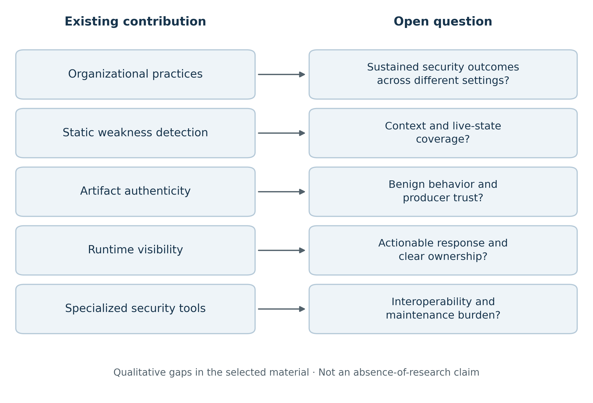

## Abstract

DevSecOps integrates security responsibilities and practices into continuous integration and continuous delivery or deployment (CI/CD). Existing research addresses organizational collaboration, automated vulnerability detection, infrastructure configuration, software supply-chain integrity, and continuous monitoring. However, these contributions differ in purpose, evidence, and scope: a practitioner survey describes adoption, a scanner study examines selected weaknesses, and a security specification defines requirements without independently demonstrating operational effectiveness. This paper critically reviews selected academic studies, official security frameworks, and documented delivery-related incidents. The literature is organized into six themes: organizational integration, application and dependency security, infrastructure as code, identity and secrets management, artifact and build integrity, and runtime monitoring. Comparative tables distinguish study designs, reported contributions, limitations, and unresolved questions. Conceptual figures summarize literature themes, evidence types, lifecycle coverage, and research gaps. The synthesis shows that early detection, deployment safeguards, and runtime observation address complementary concerns. Recurring limitations include context-dependent detection, differences between declared and actual infrastructure state, excessive pipeline privilege, incomplete verification of artifacts, and the gap between monitoring and effective response. Historical incidents illustrate why security must encompass the delivery process as well as application code. The paper concludes with a discussion of established defensive approaches and open research questions. Its contribution is a qualitative synthesis of existing work; it introduces no new implementation, experimental results, tested architecture, or experimental evaluation plan.

**Keywords:** DevSecOps; CI/CD; literature review; software supply-chain security; infrastructure as code; vulnerability detection; secrets management; continuous monitoring.

## 1. Introduction

Continuous integration and continuous delivery or deployment have changed how software is built, tested, and released. Pipelines connect source repositories, dependency registries, testing environments, artifact stores, cloud identities, and production infrastructure. Their automation can improve consistency, but it also concentrates execution authority. A weakness in a build script, dependency, credential, or deployment configuration can affect systems beyond the application under development.

DevSecOps addresses this problem by extending security responsibilities across development and operations. It includes technical mechanisms such as source-code analysis, dependency inspection, configuration checks, artifact verification, and monitoring. It also includes the organizational work of defining ownership, communicating risks, maintaining policies, and responding to findings. The literature consequently spans software engineering, application security, cloud configuration, identity management, and software supply-chain assurance.

These areas should not be treated as interchangeable. A tool that identifies a configuration weakness does not necessarily establish whether that weakness exists in a deployed environment. A signature can authenticate an artifact without demonstrating that its contents are benign. A team can report strong collaboration while still allowing a privileged pipeline to execute unreviewed code. A useful review must therefore explain both the contribution of each approach and the boundary of the conclusion it supports.

This paper reviews existing work on security integration in CI/CD, concentrating on defensive practices and their limitations. It compares research methods and contributions, relates security approaches to delivery stages, and examines unresolved issues across the selected literature. Historical incidents are used to illustrate mechanisms already discussed in security guidance. They are not used to estimate incident frequency or to claim that one control would have prevented an entire attack.

The review addresses four questions:

1. **RQ1:** How does existing research describe organizational and technical integration of security into CI/CD?
2. **RQ2:** Which existing defensive approaches address different stages and risks in the delivery lifecycle?
3. **RQ3:** How do the contributions and limitations of the reviewed studies and security frameworks compare?
4. **RQ4:** Which unresolved challenges and research gaps emerge from this comparison?

The contribution is a critical synthesis of existing literature. The figures are explanatory diagrams and the tables are comparisons of reviewed material. The paper does not propose a new delivery framework, report an implementation, or present an experimental study.

## 2. Review Scope and Approach

### 2.1 Type of review and material considered

This is a focused critical literature review. Source selection was purposive rather than the result of a completed, independently reproducible systematic search. The paper therefore does not claim exhaustive coverage, a PRISMA screening record, or a representative distribution of all DevSecOps publications.

The material examined comprises five academic manuscripts and seven official project or agency sources. The academic material covers practitioner security integration, a historical mapping of infrastructure-as-code research, security smells in infrastructure scripts, state-reconciliation defects, and Kubernetes configuration detection. The official material covers CI/CD threat categories, application-security requirements, supply-chain provenance, authorized production steps, dependency consumption, security-practice heuristics, and known exploitation.

The academic manuscripts were available through an author's publication archive. All five share a coauthor, which creates a significant concentration of perspective. They were inspected as author-hosted versions rather than independently checked final publisher copies. This limits field-wide conclusions and makes broader scholarship an important requirement for a comprehensive review. Sources were retrieved on 23 October 2026; that date does not imply complete coverage through 2026.

### 2.2 Basis of comparison

Each academic study is compared by research focus, method, reported sample or corpus, principal contribution, and limitation. A sample size is used to describe the scope of its source study, not as a result generated by this review. Frameworks are compared by the security question they address, the mechanism they define, and what remains outside that mechanism's assurance.

The analysis separates three forms of evidence:

- **Academic studies:** observations, classifications, and findings produced in defined research settings.
- **Specifications and guidance:** requirements, threat categories, and recommended mechanisms.
- **Incident material:** accounts that illustrate how particular delivery-related failures can occur.

These forms answer different questions. A specification explains what a verifier should check; an empirical study may show how a tool behaves on a particular dataset; an incident demonstrates that a failure mechanism occurred in a particular setting. Their conclusions cannot be combined into a single security-effect percentage.

### 2.3 Interpretation and claim boundaries

The review distinguishes adoption from effectiveness, detection from prevention, artifact authenticity from benign behavior, and alert generation from incident response. It does not treat zero scanner findings as proof that no vulnerabilities exist. It also does not reproduce universal remediation-cost multipliers or claims about the leading cause of cloud breaches without a defined population and suitable evidence.

Some consulted manuscripts contain discrepancies between numerical summaries, table entries, or associated publication pages. The discussion consequently emphasizes consistent qualitative findings and avoids the disputed prevalence and acceptance figures. No numerical performance chart, pooled effect estimate, or new experimental result is presented.

## 3. Critical Review of Existing Research

### 3.1 Organizational integration and shared responsibility

An exploratory practitioner study combines analysis of Internet artifacts with a survey of representatives from nine organizations. Its contribution is to show how security requirements, configuration practices, monitoring, and collaboration appear within DevOps activity. The study treats security integration as more than a technical stage added to an existing pipeline.

The organizational argument is persuasive because developers, operations staff, and security specialists influence different parts of the same delivery system. Developers modify application and build logic, operations staff maintain execution and deployment infrastructure, and security specialists help interpret threats and requirements. Findings that cross these boundaries need ownership and communication if they are to produce action.

However, collaboration should not be confused with unrestricted access. The reviewed work also discusses the danger of inappropriate resource access and the possibility that rapid deployment overlooks security practices. Shared responsibility therefore does not require shared administrator credentials or the removal of authorization boundaries.

The evidence is exploratory and partly self-reported. The study does not establish a causal relationship between automation and the security of deployed software. Its findings support an account of adoption and reported practice, rather than a general claim that a particular team structure reduces breaches. This distinction recurs throughout DevSecOps research: organizational enablers are important, but their operational consequences require separate evidence.

### 3.2 The development of infrastructure-as-code research

A historical mapping study organizes infrastructure as code (IaC) research into frameworks or tools, adoption, empirical investigation, and testing. Its selected corpus contains 32 publications, with collection completed in 2017. Half of that corpus is classified as framework or tool work. This describes a particular historical literature set and should not be interpreted as the present distribution of DevSecOps research.

The mapping nevertheless provides an important distinction for this review. A tool proposal, an integration demonstration, and an investigation of weaknesses are different research contributions. A paper can establish that a mechanism is technically feasible while leaving its accuracy, usability, maintenance demands, or operational benefit unresolved.

Infrastructure as code is especially relevant because the same automation that makes infrastructure repeatable can reproduce insecure choices. Reviewable configuration files can improve visibility, but their safety depends on the rules applied, the values supplied, and the behavior of the executing platform. Treating configuration as code creates an opportunity for security review; it does not automatically make the resulting infrastructure secure.

### 3.3 Security smells and contextual interpretation

A security-smell study examines 15,232 infrastructure scripts from 293 open-source repositories. It identifies recurring weakness patterns and develops static analysis to locate them. Examples include hard-coded secrets and insecure defaults. The work supports the inclusion of infrastructure artifacts within security analysis, rather than limiting attention to application source code.

A central interpretive point is that a smell indicates a potential weakness. It is not equivalent to a confirmed exploit or a documented production incident. Its consequence may depend on whether a script is an example, whether a credential is valid, which environment uses the configuration, and what external restrictions apply.

Context also complicates developer responses. A pattern intended for training may have limited immediate exposure while still encouraging unsafe reuse. Conversely, treating every example or test fixture as a production vulnerability can produce unnecessary noise. The literature therefore supports contextual investigation and accountable decisions rather than unconditional acceptance or dismissal of every finding.

The study's language and repository setting also limit generalization. Results from one infrastructure language do not demonstrate complete coverage of Terraform, Kubernetes, managed-cloud services, or provider-specific runtime semantics. Security patterns need to be interpreted within the environment in which they are used.

### 3.4 State reconciliation and actual infrastructure behavior

A study of 5,110 Ansible-related state-reconciliation defects identifies eight defect categories. State reconciliation is the process through which an automation engine compares intended and existing infrastructure state and determines the changes to apply. Examining defects in that engine extends the discussion beyond the configuration file itself.

This contribution explains a limitation of relying exclusively on static configuration approval. A declaration is interpreted through an orchestrator, inventory, variables, providers, and remote interfaces. Defects or unexpected interactions in those components can produce behavior that differs from the reviewed text.

The implication is not that static analysis lacks value. Static checks and observations of deployed state address different parts of the same problem. The former examine known patterns before a change is applied; the latter help reveal execution effects and later drift. Their contributions are complementary.

The reviewed defect study is specific to its investigated setting and should not be generalized into a claim that all infrastructure tools fail in the same way. Its use of generated inputs for defect discovery also does not establish reliable autonomous remediation. For a literature review, the relevant lesson is that infrastructure security depends on both declared configuration and execution semantics.

### 3.5 Kubernetes configuration and detection limitations

A Kubernetes configuration study examines 53 security configurations prescribed by the Center for Internet Security (CIS), 544 configuration files, and 20 survey respondents. It compares the support and detection behavior of five static-analysis tools. The study contributes evidence that tool availability and recommendation coverage do not necessarily establish adequate detection in practice.

Its findings depend on the studied tool versions, rule mappings, configuration files, and interpretation of prescribed settings. They should not be presented as permanent rankings of current products. In addition, inconsistencies in parts of the consulted source version limit which numerical summaries can be repeated confidently. This review therefore summarizes the contribution qualitatively rather than reproducing a performance graph.

The broader point is that combining tools can increase the number of patterns inspected while also introducing duplicated findings, inconsistent classifications, and maintenance costs. Tools that share similar rules can share blind spots. A large alert volume does not by itself demonstrate broader meaningful coverage.

Configuration analysis also depends on context. A static file may omit values that are inserted later, use templates that require rendering, or describe only one part of a cluster's configuration. The literature consequently supports distinguishing rule support, detection behavior, and actual deployed exposure.

### 3.6 Major themes across the selected literature

Figure 1 groups the reviewed topics into six connected themes. Organizational integration establishes responsibility; code and dependency checks examine selected weaknesses; infrastructure analysis addresses configuration and execution; identity management constrains authority; supply-chain mechanisms protect production and distribution relationships; and monitoring informs operational awareness.

**Figure 1. Major themes in the reviewed DevSecOps literature.**

{width=6.5in}

The figure is a qualitative organization of selected material. The size and placement of the themes do not represent publication counts, effect sizes, or their relative importance in every organization.

The themes overlap. A dependency-installation script can be simultaneously a supply-chain input, an execution risk, and a route to credential exposure. A configuration finding may require both a code change and an authorization decision. These overlaps explain why a review organized only by product names would miss important relationships.

**Table 1. Contributions and inference boundaries of the reviewed evidence.**

| Evidence stream | Contribution to understanding DevSecOps | Conclusion it does not establish |
|:--|:--|:--|
| Practitioner research | Reported collaboration and security practices | Universal causal reduction in breaches |
| Historical literature mapping | Classification of a selected body of IaC research | Current distribution of all DevSecOps scholarship |
| Security-smell research | Recurring weakness patterns in sampled scripts | Successful exploitation of every flagged pattern |
| Reconciliation-defect research | Weaknesses in infrastructure execution behavior | Correct live state from static approval alone |
| Configuration-tool comparison | Context-specific detection and coverage limitations | Permanent rankings of current products |
| Security specifications | Defined requirements and verification mechanisms | Operational benefit from adoption alone |
| Incident and exploitation material | Examples of observed failure mechanisms | Population-wide frequency or guaranteed prevention |

### 3.7 Comparison of the academic studies

Table 2 compares the five academic studies by scope and contribution. Their units of analysis differ: organizations, publications, scripts, defect records, and configuration files. Those units are retained to prevent an apparent sample-size ranking from replacing critical interpretation.

**Table 2. Comparison of reviewed study designs, reported scope, contributions, and limitations.**

| Study focus | Design and reported scope | Main contribution | Limitation and open question |
|:--|:--|:--|:--|
| Organizational integration | Exploratory artifact analysis and survey of nine organizations | Explains reported collaboration, requirements, and security practices | Small and partly self-reported sample; operational consequences remain context-dependent |
| Historical IaC research | Mapping of 32 publications, collected through 2017 | Distinguishes tool, adoption, empirical, and testing work | Historical and search-dependent corpus; broader and updated coverage is needed |
| IaC security smells | Static-analysis study of 15,232 scripts from 293 repositories | Characterizes recurring weakness patterns and their interpretation | Smells are not confirmed exploits; language and deployment context limit generalization |
| State reconciliation | Study of 5,110 Ansible-related defects and eight categories | Shows why execution-engine behavior matters alongside configuration text | Orchestrator-specific setting; findings do not establish universal infrastructure behavior |
| Kubernetes configuration | Five tools, 53 prescribed configurations, 544 files, and 20 respondents | Shows limitations in recommendation coverage and configuration detection | Version, mapping, and dataset dependence; source discrepancies require caution |

Across these studies, a recurring boundary separates an intermediate observation from an operational conclusion. Collaboration is not correct authorization; a detected smell is not containment; and a configuration declaration is not the deployed system. Figure 2 summarizes how the different evidence streams inform the review's comparative questions.

**Figure 2. Evidence types used in the review and the questions they support.**

{width=6.5in}

The arrows indicate the organization of the review. They are not causal relationships or a systematic-search screening flow. The figure describes how existing material is interpreted, not a new technical framework.

## 4. Comparison of Existing Security Approaches

### 4.1 Security frameworks address different questions

OWASP's CI/CD risk taxonomy identifies delivery-process risks such as poisoned pipeline execution, inadequate identity controls, exposed credentials, artifact-integrity failures, and insufficient visibility. Its main contribution is to organize threats for assessment. A taxonomy does not deploy controls or measure how frequently those threats occur.

The OWASP Application Security Verification Standard (ASVS) provides application-security verification requirements. Its contribution is a versioned basis for asking what should be checked in an application. Some requirements can be supported by automated checks, while others need architectural reasoning or manual assessment. ASVS is therefore distinct from a scanner and does not automatically verify compliance with its own requirements.

Supply-chain Levels for Software Artifacts (SLSA) v1.1, the version examined here, describes supply-chain and build-integrity guarantees using provenance and consumer verification. It addresses whether an artifact's production can be connected to expected processes and trusted builders. It does not establish that the source is benign or that a producer has good intentions. Naming the reviewed version is important because the specification evolves.

The in-toto specification describes authorized production steps and artifact relationships through signed metadata and defined verification rules. Its contribution is to make expected handling explicit and checkable. Protection still depends on complete rules, correctly authorized actors, protected trust material, and actual verification by a consumer.

The OpenSSF Secure Supply Chain Consumption Framework (S2C2F) concentrates on secure consumption of open-source components. Scorecard provides security-practice heuristics that can inform maintenance and dependency decisions. The Cybersecurity and Infrastructure Security Agency (CISA) exploitation catalog supplies information about known exploitation of listed vulnerabilities. Each informs a different part of the decision process; none alone describes the complete security of an application and its delivery system.

**Table 3. Comparison of reviewed frameworks and information sources.**

| Framework or source | Primary question | Mechanism or contribution | Remaining limitation |
|:--|:--|:--|:--|
| OWASP CI/CD risk taxonomy | Which delivery-process threats deserve attention? | Risk categories for pipeline assessment and control selection | Categories do not measure incidence or establish control effectiveness |
| OWASP ASVS 5.0.0 | Which application requirements should be verified? | Versioned requirements for automated and manual assessment | Requirement coverage and evidence quality must be established |
| SLSA v1.1 | What build-integrity guarantees accompany an artifact? | Provenance and verification against trusted production expectations | Correct provenance does not prove benign source or producer intent |
| in-toto 1.0.0 | Were authorized steps and artifact relationships followed? | Signed layouts and step metadata with verification rules | Incomplete rules and compromised trust roots can weaken protection |
| OpenSSF S2C2F | How should open-source consumption be governed? | Dependency-ingestion practices and maturity guidance | Governance does not establish the absence of vulnerable or malicious components |
| OpenSSF Scorecard | Which observable security practices warrant attention? | Automated heuristic checks for maintenance and dependency assessment | A score is not a calibrated probability of compromise |
| CISA exploitation catalog | Is exploitation of a listed vulnerability known? | Information supporting prioritization of affected assets | Unlisted vulnerabilities can still be exploitable |

### 4.2 Placement across the delivery lifecycle

The reviewed approaches address different lifecycle stages. Threat modeling and security requirements inform planning. Source analysis and secret detection support development. Dependency inspection, controlled build inputs, and provenance concern production of artifacts. Application assessment examines behavior. Release and deployment safeguards address artifact acceptance, configuration, and authority. Operational monitoring addresses the system after deployment.

Figure 3 summarizes these common placements. It is an explanatory map of established practices rather than a proposed implementation. In practice, several controls operate repeatedly or at multiple stages; placing them at one location in a diagram does not imply exclusive use there.

**Figure 3. Existing security approaches across the CI/CD and operational lifecycle.**

{width=6.5in}

Operational feedback informs planning and maintenance. This feedback relationship explains the term continuous security, but it does not imply that every organization has implemented or validated the same sequence of controls.

### 4.3 Application, dependency, and infrastructure analysis

Static application security testing (SAST) examines source or related representations for selected weakness patterns. Software composition analysis (SCA) examines dependencies and known vulnerability information. Dynamic application security testing (DAST) examines behavior in a running environment. Infrastructure analysis examines configuration and resource relationships. These approaches observe different objects and have different visibility limits.

For example, application source analysis may not reveal an unsafe cloud identity assigned during deployment. A dependency inventory may identify a vulnerable component without establishing whether its vulnerable behavior is reachable. A static infrastructure check may not observe a later manual change. Dynamic assessment may miss authenticated or state-dependent behavior that the test session does not exercise.

These limitations explain why combining approaches is common in guidance. They also caution against assuming that every additional tool supplies independent coverage. Overlapping rules can increase duplicate work, while inconsistent classifications can complicate triage. The literature supports comparing what is observed and what remains unseen rather than comparing products solely by the number of reported findings.

### 4.4 Identity, credentials, and execution privilege

Credential security in CI/CD concerns more than detecting secrets in a repository. Secrets can also appear in logs, container layers, caches, temporary files, and execution environments. A clean source scan therefore does not establish that a pipeline exposes no credentials.

Existing guidance emphasizes limiting the identities and resources available to each execution context. Unreviewed contributions and third-party helpers should not automatically receive the authority used to publish releases or modify production. Shared credentials and broad permissions can allow compromise in one stage to affect unrelated environments.

Temporary workload credentials reduce the period in which an exposed credential can be reused. Their value still depends on narrow trust conditions and permissions. A temporary administrator token remains powerful during its validity, and a broad federation policy can allow repeated issuance. Least privilege is therefore an effective-permission question, not simply a property implied by a role's name.

### 4.5 Artifact integrity, provenance, and inventories

Artifact signatures, provenance, and component inventories describe different properties. A signature authenticates a statement or artifact identity. Provenance records information about production. An inventory describes included components. Their usefulness depends on connecting them to the exact artifact being consumed or deployed.

A release label or mutable tag is weaker than an immutable digest for establishing that two stages handled the same bytes. Equally, collecting an attestation without checking its signer, expected producer, and subject leaves its intended protection incomplete. Existing supply-chain guidance therefore concerns both evidence production and evidence consumption.

A software bill of materials (SBOM) can assist later vulnerability response when it is connected to deployed artifacts and maintained as information changes. It does not patch software, guarantee completeness, or prove non-exploitability. The review consequently distinguishes visibility into components from action on affected systems.

## 5. Historical Failures and Defensive Lessons

Historical incidents illustrate why the delivery process belongs within security analysis. SolarWinds and Codecov are discussed through summaries in the reviewed supply-chain guidance and CI/CD taxonomy; their primary incident reports were not independently retrieved for this review. The Log4Shell discussion uses the known-exploitation catalog entry for CVE-2021-44228. These cases illustrate different mechanisms and should not be treated as identical examples of a generic pipeline weakness.

### 5.1 SolarWinds and trust in software production

The SolarWinds incident illustrates compromise of a software production process. The review lesson is that distribution through a recognized producer's release channel is not sufficient evidence of benign content. Trust in the producer, integrity of the build environment, and authenticity of the distributed artifact are related but distinct concerns.

Existing defensive approaches include protecting build infrastructure, restricting changes to production logic, verifying provenance, and maintaining separation between production and release authority. Independent reproduction can provide additional information in suitable settings. None of these establishes benign behavior by itself: malicious authorized source can be built reproducibly and signed correctly.

The case therefore supports a careful interpretation of supply-chain controls. They can constrain particular routes of tampering, but their guarantees depend on stated trust assumptions. The literature should not be read as promising that one signature or checklist prevents every form of producer compromise.

### 5.2 Codecov and authority inherited by CI helpers

The Codecov incident illustrates how externally supplied helper code can gain access to sensitive information in a build environment. The relevant issue is the authority inherited by code executed for an apparently limited purpose. A helper does not need to be responsible for deployment to cause harm if it can read deployment credentials.

Existing guidance addresses this through controlled inputs, integrity verification, execution separation, scoped credentials, and network restrictions. Pinning a dependency limits unexpected changes, while checking an independently trusted integrity expectation helps detect substitution. Neither establishes that an approved version is inherently safe.

The lesson connects dependency security and identity management. Assessing the origin of a helper and limiting the resources it can access are complementary measures. Source inspection alone does not replace an execution boundary, and a short-lived credential does not eliminate misuse during a valid session.

### 5.3 Log4Shell and vulnerability response after deployment

Log4Shell illustrates the operational consequences of a vulnerable legitimate dependency. CISA identifies CVE-2021-44228 in Apache Log4j2 as a known exploited remote-code-execution vulnerability. This differs from artifact substitution: the affected component can be genuine while still exposing dangerous behavior.

The case highlights the importance of component visibility, deployment records, advisory interpretation, and update or containment capability. An accurate inventory can support identifying potentially affected software, but identifying that software is only one part of response. Ownership and the ability to change affected deployments remain necessary.

Reachability and configuration can help interpret exposure, but incomplete analysis should not be treated as proof that exploitation is impossible. The literature lesson is that dependency security continues after an artifact has passed a build-time check, especially when knowledge about vulnerabilities changes.

**Table 4. Comparison of historical failure mechanisms and defensive lessons.**

| Case | Failure mechanism illustrated | Relevant existing approaches | Scope of the lesson |
|:--|:--|:--|:--|
| SolarWinds | Compromise of a software production process | Protected builds, provenance, controlled production changes, independent release authority | Trusted distribution and valid signatures do not alone prove benign content |
| Codecov | CI helper code inherits access to sensitive build information | Controlled inputs, isolated execution, narrow identities, integrity verification | Dependency origin and execution privilege must both be considered |
| Log4Shell | Vulnerable legitimate component remains in deployed software | Component inventories, advisory response, update and containment processes | Inventory supports response but does not remediate exposure itself |

### 5.4 Failure-prone practices and established alternatives

Security approaches can fail when their assumptions do not match the execution context or their implementation grants excessive trust. Table 5 compares problematic practices discussed in delivery-security guidance with established defensive alternatives. It is a qualitative synthesis, not an estimate of how frequently organizations use each practice.

**Table 5. Comparison of failure-prone practices and defensive alternatives.**

| Practice | Why it is limited | Existing defensive alternative |
|:--|:--|:--|
| Security only at the final release checkpoint | Important weaknesses may be discovered after dependent work accumulates | Earlier feedback alongside release and operational safeguards |
| Shared deployment identity across environments | A single compromise can cross project and environment boundaries | Narrow workload identities and context-specific permissions |
| Mutable external scripts in privileged jobs | Retrieved code can change without a reviewed repository change | Controlled inputs, trusted integrity expectations, and isolated execution |
| Treat every warning as equally important | Noise and missing context can undermine triage | Contextual prioritization, ownership, and documented exceptions |
| Treat a signature as proof of safe behavior | Authenticated origin does not establish benign content | Verification of identity and production expectations alongside application assessment |
| Produce an SBOM only for an audit | An unused or stale inventory does not support timely response | Connect component information to deployed artifacts and advisory handling |
| Assume reconciliation guarantees security | Automation can repeatedly restore an unsafe intended state | Review desired configuration and observe actual infrastructure behavior |
| Treat alert generation as incident response | A warning may have no owner or effective containment path | Actionable monitoring, assigned responsibility, and maintained response processes |

## 6. Cross-Cutting Challenges and Research Gaps

### 6.1 Context and coverage of automated detection

The reviewed configuration and security-smell studies show the value of automated inspection, while also exposing the importance of context. Detection can be constrained by language support, rule design, rendering, configuration combinations, and interpretation of intended behavior. No single inspected source demonstrates complete coverage of all delivery risks.

A recurring open question concerns how findings should express their assumptions. A warning that explains the affected resource, relevant configuration, and consequence can be more actionable than a label detached from deployment context. This issue links technical detection with the human work of investigating and maintaining fixes.

### 6.2 Intended state, execution, and configuration drift

Infrastructure security spans declared state, transformation by an automation engine, and the live environment. Static approval concerns the first of these; reconciliation defects concern the second; drift concerns the third. The reviewed material supports treating them as connected but distinct areas of visibility.

An unresolved challenge is maintaining a clear relationship among those states without assuming that one is a complete substitute for the others. The problem becomes more complex when templates, multiple repositories, provider defaults, and manual changes interact. This motivates a review of complementary observations rather than a claim that one tool resolves the whole lifecycle.

### 6.3 Independence and interpretation of security information

Supply-chain specifications provide structures for expressing artifact relationships and production information. Their value depends on which actors are trusted and which statements consumers actually verify. Evidence generated and accepted under a single compromised authority can share the same failure boundary.

This does not make signed information useless. It means that its interpretation must remain proportional to its source and scope. A statement about how software was produced, an application test, and a runtime observation provide different kinds of knowledge. Combining them is an organizational and technical integration challenge, not a justification for collapsing them into one unqualified score.

### 6.4 Maintenance burden and developer adoption

DevSecOps controls require upkeep. Rules change, dependencies evolve, exceptions expire, identities drift, and teams change responsibilities. A successful initial integration does not establish that a control will remain accurate or usable over time.

The practitioner literature also highlights the importance of collaboration and non-automated activity. Tool findings must enter an understandable workflow with an accountable owner. Too many overlapping results can consume effort without resolving the most relevant exposure. The open issue is sustained, context-sensitive use, not simply whether a pipeline can execute a scanner.

### 6.5 Runtime visibility and response

Monitoring can reveal changes that pre-deployment checks cannot observe, but visibility is not equivalent to successful response. Logs can be incomplete, alerts can lack context, and remediation can be delayed by unclear ownership. Protecting telemetry and maintaining response responsibility therefore remain part of the reviewed defensive picture.

The literature also cautions against relying exclusively on build-time information. Newly disclosed vulnerabilities and changed deployments can alter the interpretation of an existing release. Continuous security is best understood here as continued attention to changing conditions, rather than a promise that automation has eliminated residual risk.

**Table 6. Comparison of existing approaches by lifecycle stage.**

| Stage | Existing approaches | Main contribution | Common limitation |
|:--|:--|:--|:--|
| Plan | Threat modeling, security requirements, ownership | Clarifies assets, assumptions, and responsibility | Analysis can become outdated or remain disconnected from implementation |
| Code | Source analysis, secret detection, review | Identifies selected weaknesses before release | Pattern coverage and context remain incomplete |
| Build | Dependency inspection, controlled inputs, build isolation | Examines components and limits production-process exposure | Unknown flaws and trusted-component compromise remain possible |
| Test | Application assessment and requirement-based verification | Examines behavior and application requirements | Unexercised paths and environment differences limit conclusions |
| Release | Artifact signatures, provenance, authorized acceptance | Connects consumed artifacts to expected identity and production | Valid statements do not establish benign content |
| Deploy | IaC inspection, scoped identities, configuration policy | Addresses intended resources and deployment authority | Execution semantics and subsequent drift can change actual exposure |
| Operate and monitor | Live-state observation, telemetry, advisory response | Supports awareness of changing conditions after deployment | Visibility can remain incomplete or fail to produce effective response |

### 6.6 Synthesis of open questions

Figure 4 and Table 7 summarize the gaps suggested by the selected material. They describe unresolved relationships between existing contributions and broader security conclusions. They do not claim that no prior publication has considered these issues; establishing such absence would require a more comprehensive search.

**Figure 4. Open questions emerging from the comparison of existing literature.**

{width=6.5in}

The figure contains no performance values or new experimental findings. It visualizes the review's interpretation of remaining questions across the selected sources.

**Table 7. Research gaps synthesized from the reviewed material.**

| Theme | Existing contribution | Unresolved issue | Direction for further literature development |
|:--|:--|:--|:--|
| Organizational integration | Descriptions of collaboration and adoption practices | Relationship to sustained operational security remains context-dependent | Broader synthesis of organizational settings and long-term experience |
| Automated detection | Identification of known code and configuration patterns | Context, language coverage, and meaning of combined findings | More comparable reporting of scope, assumptions, and limitations |
| Infrastructure behavior | Studies of declarations and reconciliation defects | Relationship among intended, executed, and live state | Integration of knowledge across configuration and runtime research |
| Supply-chain integrity | Provenance, signatures, and authorized-step specifications | Difference between authenticated production and benign behavior | Clearer synthesis of trust assumptions and consumer verification |
| Identity and secrets | Guidance on credential hygiene and narrow permissions | Effective privilege across connected tools and temporary identities | Closer treatment of identity relationships throughout delivery |
| Runtime response | Monitoring and post-deployment visibility | Ownership, actionability, and changing exposure | Stronger connection between detection literature and response practice |
| Tool integration | Multiple specialized mechanisms across the lifecycle | Duplication, interoperability, and continuing maintenance effort | Comparative accounts of integration costs and sustained usability |

## 7. Discussion and Review Limitations

### 7.1 Answers to the review questions

For **RQ1**, existing work describes security integration as a combination of organizational practices and technical mechanisms. Collaboration and ownership influence whether security concerns become part of normal delivery work. Technical controls extend visibility into code, components, infrastructure, artifacts, and running systems.

For **RQ2**, the approaches differ in what they observe and control. Source and configuration analysis inspect selected pre-deployment weaknesses; identity controls limit authority; supply-chain mechanisms establish expected production relationships; and monitoring addresses conditions after deployment. Their overlap is useful, but it does not eliminate individual limitations.

For **RQ3**, the academic studies provide context-specific observations and classifications, while frameworks define requirements or verification mechanisms. Table 2 distinguishes the research contributions and their inference boundaries. Table 3 shows why the frameworks are complementary rather than interchangeable measures of security.

For **RQ4**, the recurring gaps concern context-aware detection, infrastructure execution, interpretation of signed information, effective privilege, maintenance burden, and operational response. These are conclusions from comparing the selected material, not claims of a newly discovered absence across the entire research field.

### 7.2 Implications for understanding DevSecOps

The review supports moving beyond a binary account of pipelines with or without security. Actual systems contain partial coverage, inherited protections, exceptions, and different operational constraints. A meaningful comparison explains which risks an approach addresses and what remains uncertain.

Likewise, the number of tools is a weak summary of the security process. Several tools can depend on the same rules or execution authority. A framework can improve consistency of questions without answering them automatically. A monitoring platform can collect data without ensuring that a relevant event receives action.

The defensive lesson across the literature is therefore one of complementarity and explicit assumptions. Early feedback, bounded execution, artifact verification, configuration visibility, and maintained response address different concerns. Their suitability depends on the application, infrastructure, organization, and threats under consideration.

### 7.3 Limitations of this review

**Selection and breadth:** The review uses a purposive, access-constrained source set. The academic sources share a coauthor, and independent viewpoints are underrepresented. The synthesis cannot establish field-wide prevalence or exhaustive novelty claims.

**Source versions:** Author-hosted manuscripts may differ from final publications, and project specifications evolve. Some numerical inconsistencies limit the conclusions that can be repeated from the consulted versions. The discussion therefore favors supported qualitative interpretations and names the reviewed specification versions.

**Different forms of evidence:** Practitioner reports, mined artifacts, standards, and incidents have different strengths and limitations. Their findings are compared narratively rather than pooled into a single performance estimate.

**Incident interpretation:** The SolarWinds and Codecov discussion relies on summaries in the reviewed guidance. Incidents illustrate mechanisms but do not demonstrate how frequently those mechanisms occur or prove that a specific combination of controls would have prevented the entire attack.

**Generalizability:** Technology, organizational context, and attacker capability vary. The review does not establish that an approach is universally sufficient, nor does it present an implementation with independently validated benefits.

## 8. Conclusion

Existing DevSecOps research addresses a broad set of organizational and technical concerns across CI/CD. The reviewed studies contribute knowledge about collaboration, infrastructure weaknesses, execution defects, and configuration detection. Security frameworks provide complementary ways to organize application requirements, delivery threats, dependency governance, and artifact verification.

The comparison shows why these contributions should be interpreted within their scope. Adoption does not prove effectiveness; a warning does not establish an exploit; intended configuration does not guarantee actual behavior; and authenticated production does not prove benign content. Historical incidents reinforce the need to consider the delivery process as well as application code.

The figures and tables organize these relationships and the remaining questions in existing work. The principal review finding is that DevSecOps depends on complementary practices, contextual interpretation, and continued maintenance across the lifecycle. Broader, more diverse literature coverage remains necessary for a comprehensive systematic synthesis. This paper contributes a focused critical review, not new experimental evidence or a proposed technical system.
