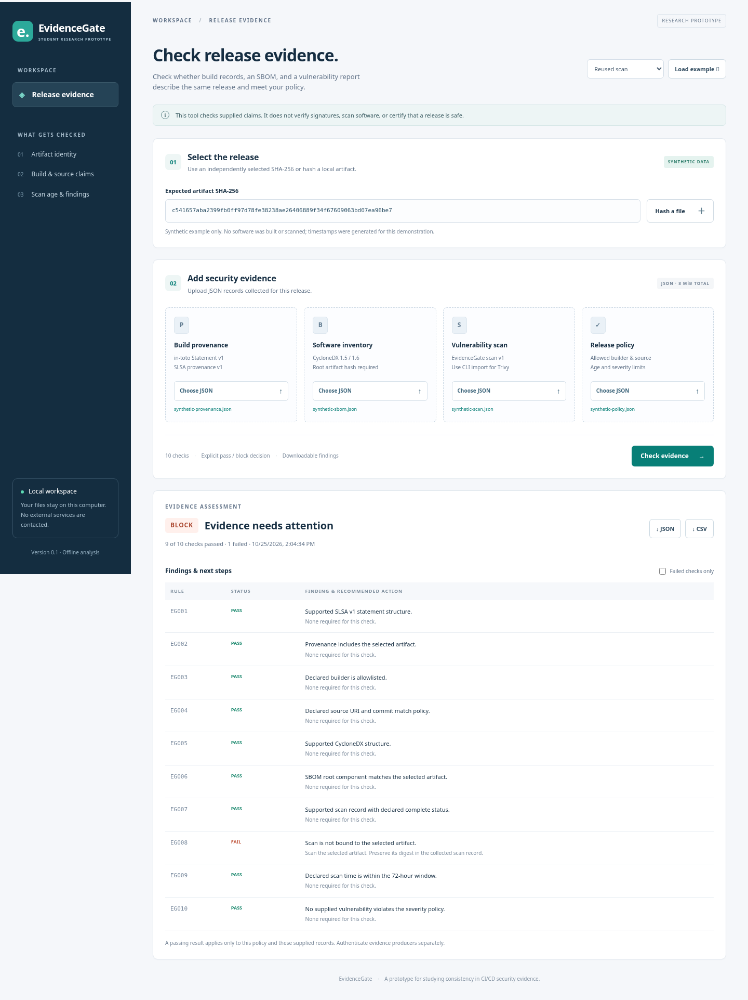

# EvidenceGate

**A working student research prototype for checking CI/CD security evidence.**

A release can have a valid-looking SBOM and a clean scan that describe an older artifact. EvidenceGate compares both records and build provenance with an independently selected SHA-256, then applies source, builder, freshness, and vulnerability policies.

All project files are inside this new folder. The existing review paper and its assets are unchanged.

[Download the tool ZIP](EvidenceGate_Tool.zip) · [Research guide](docs/RESEARCH_PLAN.md) · [Validation record](docs/VALIDATION.md)



## Start the tool

Requires **Python 3.10 or newer**. No third-party Python libraries, account, API key, or cloud service is required.

Download this GitHub repository, extract it, then open a terminal inside its `evidencegate` folder:

```bash
python -m evidencegate serve
```

Open **http://127.0.0.1:8765** in your browser. Select **Load example**, then **Check evidence**. Try **Reused scan** to see the artifact-mismatch rule block it. These examples are synthetic.

Windows users can replace `python` with `py -3` if needed. Stop the server with **Ctrl+C**. The dashboard runs on your computer; GitHub previews source files but does not host the running application.

## What it checks

| Problem | Check | Response |
|:--|:--|:--|
| An older report accompanies a new release | Compare provenance, SBOM root hash, and scan subject with the selected digest | Block mismatches |
| Unexpected build or source claims | Compare declared builder, repository URI, and full Git commit with policy | Block policy violations |
| Missing or incomplete evidence | Check the supported structure and explicit scan status | Block missing or unsupported records |
| Outdated vulnerability information | Check declared scan time against a maximum age | Block stale or implausible timestamps |
| High-risk findings | Compare supplied severities with the blocking policy | Block matching findings |

Supported inputs: raw **SLSA provenance v1 / in-toto Statement v1**, **CycloneDX JSON 1.5/1.6**, and **EvidenceGate scan v1**. A CLI adapter imports **Trivy JSON SchemaVersion 2** for OCI-image manifest digests.

Reports contain rule IDs, pass/fail decisions, and concrete remediation steps. Export **JSON**, **CSV**, or a portable **HTML** report.

## Command-line demonstration

Run these commands inside this folder:

```bash
python -m evidencegate demo
```

Open `outputs/demo/clean/index.html` and `outputs/demo/mismatch/index.html`. The command generates input examples and identifies a deliberately reused scan.

To check those freshly generated files:

```bash
python -m evidencegate check --artifact outputs/demo/inputs/artifact.txt --provenance outputs/demo/inputs/provenance.json --sbom outputs/demo/inputs/sbom.json --scan outputs/demo/inputs/scan.json --policy outputs/demo/inputs/policy.json --output-dir outputs/my-check
```

For a real release, replace these paths with your collected evidence and use your own policy. Use `--sha256` instead of `--artifact` when selecting an OCI manifest digest. **Do not compare an archive-file hash with an OCI manifest or image configuration digest.**

Exit codes: **0** = supplied evidence passes; **1** = blocked; **2** = invalid input or command. Any nonzero result should fail a CI gate.

## Research evaluation

```bash
python -m evidencegate benchmark --seed 7 --repeats 10
python -m unittest discover -s tests -v
```

The benchmark constructs **27 labeled synthetic cases** and compares three modes: document presence, the checker without artifact-binding rules, and the full checker. It exports inputs, per-case decisions, confusion counts, and measured rule-evaluation time.

- [Research plan and paper outline](docs/RESEARCH_PLAN.md)
- [Actual synthetic demonstration results](examples/synthetic-benchmark/evaluation.md)
- [Input formats and policy](docs/INPUT_FORMATS.md)
- [Architecture, rule reference, and threat model](docs/DESIGN.md)
- [Trivy import instructions](examples/TRIVY_IMPORT.md)
- [Example CI step](examples/github-actions-step.yml)

These constructed cases demonstrate rule behavior. They do **not** establish real-world accuracy, production performance, or research novelty. An independent dataset and comparison with existing solutions are needed for stronger paper claims.

## Trust boundary

EvidenceGate checks the consistency of supplied claims. It **does not verify cryptographic signatures**, authenticate builders, run a scanner, or prove harmless software behavior. Forged but mutually consistent inputs may pass. Authenticate evidence externally and collect it through a trusted pipeline.

The example policy uses fictional builder/source identities. Configure your actual allowlist and expected commit before applying it to real evidence. Never edit mismatched records merely to make a release pass.

## Optional installation

For use outside this folder:

```bash
python -m pip install .
evidencegate --help
```

The module commands above work without installation. Generated local outputs are ignored by Git. Checked-in examples use a fixed assessment time; run `demo` again to obtain fresh examples.
