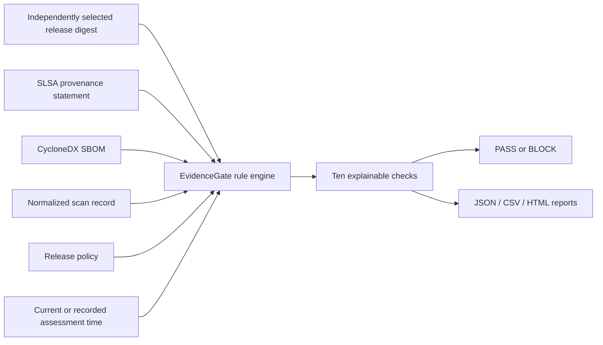

# Design and scope

## Architecture

The dashboard and CLI call the same Python evaluator. The dashboard binds only to `127.0.0.1`, rejects unexpected hosts/origins, and does not execute or save uploaded evidence. The CLI supports automation and durable reports.

## Rules

| ID | Check | Failure condition |
|:--|:--|:--|
| EG001 | Provenance structure | Missing or unsupported statement |
| EG002 | Provenance subject | Selected release digest absent |
| EG003 | Declared builder | Builder not allowlisted |
| EG004 | Declared source | URI/commit absent, different, or conflicting |
| EG005 | SBOM structure | Unsupported or malformed SBOM |
| EG006 | SBOM artifact hash | Root digest absent, different, or conflicting |
| EG007 | Scan structure | Missing, malformed, or declared partial scan |
| EG008 | Scan subject | Digest differs from selected release |
| EG009 | Scan time | Missing, invalid, stale, or implausibly future date |
| EG010 | Vulnerability policy | A supplied finding has a blocked severity, or scan is invalid |

Any failed rule produces `BLOCK`. Invalid policy, unreadable input, and malformed JSON produce exit code 2. There is no weighted security score: all ten configured conditions must hold.

## Threat model

The tool targets evidence mix-ups, reuse of reports for another artifact, stale records, and policy violations visible in the supplied claims. It can also reveal substitutions that leave a mismatching record.

The release digest and policy must come from an independent, trusted selection process. Evidence authenticity and collection integrity must be established outside the tool. An attacker able to forge all consistent fields can bypass these checks.

| Condition | Within scope? |
|:--|:--|
| Old SBOM or scan paired with a different release digest | Yes |
| Different declared builder/source from configured policy | Yes |
| Stale declared scan timestamp | Yes |
| Known finding included with a blocked severity | Yes |
| Forged signatures or false builder/source declarations | No cryptographic verification |
| False timestamps or deliberately hidden vulnerabilities | Not observable without trusted collection |
| Vulnerabilities the scanner misses | No independent scanning |
| Malicious software with consistent, authentic records | No behavior verification |
| Real deployment differs from the selected digest | Deployment enforcement is external |

This is a policy-checking prototype, not an implementation of SLSA compliance or a replacement for Sigstore, in-toto verification, or a vulnerability scanner.

## Research comparison

`presence_only` asks whether three evidence documents exist. It is a deliberately weak conceptual baseline.

`without_artifact_binding` retains seven policy/structure checks while excluding EG002, EG006, and EG008. This ablation isolates the value of binding the supplied records to the chosen release.

Neither baseline represents a named existing product. Compare against a configured existing verification/policy solution on the same inputs before claiming superiority or novelty.
